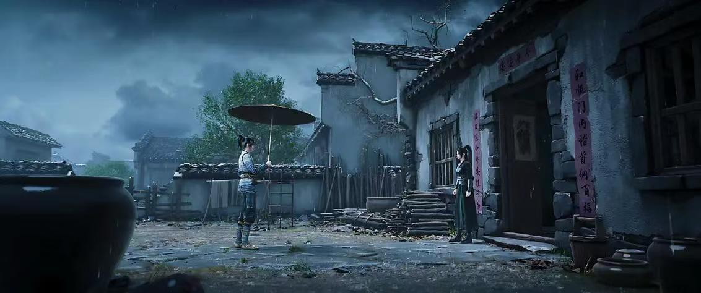
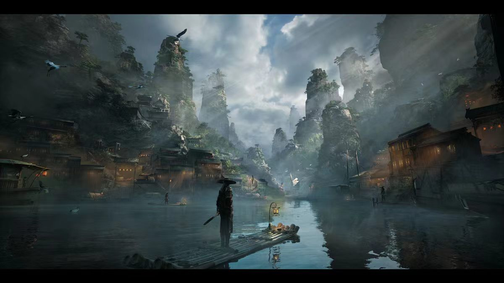

这是我经过别的大佬已经开源的漫剧skill加上自己在实际使用中遇到的情况进行了一定调整的剧本到资产到分镜到提示词的skill。

# 阿良的分镜制作规则

一句话：**剧本验收过了才进分镜，分镜验收过了才进分段，每一份交给 AI 视频工具的东西都必须粘贴即用。**

目标模型 **MiniMax H3**（单次 4–15 秒，整数秒）。这个技能**逐件交付、每件过门**（R65）：先出剧本，你看过点头后再出人物资产，再问要不要出场景与道具资产，然后才是分镜，最后是分段＋交接。**这一层的交付物叫「分镜视频」（`分镜视频.md`，原名分段视频提示词，R69）；分镜走「六列镜头表 → 六项自检 → 文本分镜」三件套（R70）——旧的九栏体与陈述句体已整条删除，不留兼容；表情／对话／打斗／打斗特效先在分镜写全（R67），分段只译、不重写（R66）。** 产出清单：

```
剧集/<EP>/剧本.md          ← 场次 + 场景站位 + 台词 + 声音设定
剧集/<EP>/资产提示词.md     ← 人物 C / 场景 S / 道具 P 编号 + 可直接用的生图提示词
剧集/<EP>/人物资产.md       ← 四项提示词：面部特写／正面／侧面／背面（不分层、不问层）
剧集/<EP>/分镜/镜头表.md    ← 六列镜头信息表（镜号与秒数／交接／空间锚与身份／钩子／逐秒指令／声音总谱）＋顶部六项自检 PASS/FAIL（R70）
剧集/<EP>/分镜/文本分镜.md  ← 全片一镜一节、十一字段、逐格四象限（R70，唯一的渲染权威）
剧集/<EP>/分镜视频.md      ← 一镜一段（分镜几镜就几段，每段只一个 [Shot 1]），逐字照 references/分镜视频模板.md（R56／R63／R69）
```

## 人物资产默认画风（REF-900）
## 人物资产默认参考画风（REF-900，R64）
人物画风只问一次。用户没有另给人物参考图或文字描述、答「默认／随便／你定／没有别的」，就直接用这套内置默认画风，不再追问；用户明确给了别的图或描述，以用户的为准。


- **中文质感词**：`电影级三维写实国风仙侠，半写实瓷白肌肤与细腻东亚五官，半透明多层真丝汉服，月白／冰蓝主色（深青与银灰点缀），柔和的正面棚拍光，纯白无缝背景，全身站姿，高精度布料褶皱与银饰，浅景深，无赛璐璐勾线。`
- **英文质感词**：`cinematic 3D realistic Chinese xianxia character render, semi-realistic porcelain skin and delicate East Asian features, translucent layered silk hanfu, moon-white / ice-blue palette (deep teal and silver-grey accents), soft frontal studio light, pure white seamless background, full-body standing pose, high-precision fabric folds and silver ornaments, shallow depth of field, no cel shading.`
- **英文锁**：`cinematic 3D realistic Chinese xianxia character render, semi-realistic porcelain skin and delicate East Asian features, translucent layered silk hanfu, moon-white and ice-blue palette with deep teal and silver accents, soft neutral studio key light, seamless white background, full-body standing pose, high-detail fabric folds and silver ornaments, shallow depth of field, no cel shading, no anime outline.`
- **取什么（R64：不再是「锁」）**：只借渲染质感、配色体系、材质精度、打光方式；人脸长相、身材、服装款式、姿态构图、场景地点、道具种类一律按剧情写；参考图与剧情冲突时以剧情为准。
- **场景与道具**：另有一套默认 `REF-902`，没有另给就自动使用；详见下一节。

## 场景与道具默认画风（REF-902）

场景与道具画风也只问一次。用户没有另给图或文字、答「默认／随便／你定／没有别的」，就直接用这套内置默认画风，不再追问；明确给了别的图或描述，以用户的为准。下面两张同属一套：近景看村落、青石与道具材质，大景看山河、雾光与空气透视。




## 场景与道具默认参考画风（REF-902，R64）
- **画风名**：`REF-902` 雨雾仙侠·实景质感
- **中文质感词**：`电影级写实国风仙侠场景，低饱和青灰蓝主调、暖琥珀灯火点缀，柔散天光与体积雾，真实物理材质，青石／旧木／夯土／青苔的湿润粗糙质感，空气透视与浅景深，道具为粗陶／竹木／旧铁／湿布／纸面。`
- **英文质感词**：`cinematic realistic Chinese xianxia environment, low-saturation blue-grey palette with warm amber lantern accents, soft diffuse daylight with volumetric fog, physically based materials, bluestone and weathered timber, deep focus landscape.`
- **取什么（R64）**：只借场景的渲染质感、配色、材质、雾光与景深，以及道具的材质、磨损与色彩；不锁具体是村落还是山河、不锁具体道具种类——这些都按剧情写。

## 它和我改了什么

- **分段逐字照模板（R56，优先级最高）**：以用户 EP001 的 `分段视频提示词.md` 为唯一格式准绳，新增 `references/分段模板.md`。以后每集分段都写 `*` 元数据六行（时长／场景与轴线／表演参考／参考图／标签映射／说话人）；六段字段各缩进两个空格；`subject_definitions` 用固定参考供给句与 `main orientation`；`summary` 一句 `[reference generation] N shots ...`；`retention_analysis` 固定 `...: fully_preserved；head angle and eyeline are reblocked per shot; reference frontal orientation is not preserved.`；`detailed_description` 固定 `The scene is ... An outside witness records ... No subject looks into the lens ...` 开头，第二句 `Only the character who is speaking moves their lips; the rest keep lips closed.`；首镜 `[Shot 1]` 不写时间码，后续镜 `At MM:SS.mmm` 时间后不加逗号；台词全部放在镜头之后，每句 `(Sx) 角色：[Chinese] 原文`，同一角色多句各占一号；`non_diegetic_music` 写 `N/A`。旧 `<d>` 台词、350–500 词、旧 outside witness 句、`for this segment`、分段 `@Cxx` 全部作废。
- **时间码分两层（R13–R15／R18／R53／R56）**：**分镜提示词不写时间码**，每镜从「起幅：」写起、按动作顺序连续写；**分段首镜 `[Shot 1]` 不写时间码，从 `[Shot 2]` 起写 `At MM:SS.mmm`（不加逗号）**，切点严格递增且小于段长。镜长与段长只写在字段里的「镜长 N 秒」「时长 N 秒」。`check_rule.py` 分镜查 `check_no_timecode`，分段查 `check_official_timecodes`。
- **分段六段与图片中文名（R20／R20.3／R53／R54）**：六段顺序固定，六段前不许加中文约束段；叙述骨架英文，人物名、场景名、道具名、台词、屏显文字保留中文；`subject_definitions` 每条 `<Subject N>` 写成 `<Subject N>（图片名：方源）`，`summary`／`detailed_description` 正文一律写图片中文名、不写裸 `<Subject N>`／`<Picture N>`；`retention_analysis` 行首按 R54 写 `<Subject N>（图片名：…）`，这是唯一例外；人物、场景、道具参考图只作主体来源时折进 `<Subject N>`，只有首帧／尾帧／关键帧／构图锚点／故事板才单开 `<Picture N>`；没有视频输入不写 `video continuation`、不定义 `<Video N>`。
- **参考图只继承身份，不继承正脸与视线（R54）**：参考图同时带身份（五官、发型、服装、体态）与画面（取景角度、头部朝向、视线、姿态），写作时只继承身份，画面信息由分镜重新指定。每个 `<Subject N>` 定义句写死 `The reference supplies facial identity, hair and costume only; pose, head angle and eyeline follow the shot description.` 并预声明主朝向；`detailed_description` 同时写「不看镜头」与「不复制参考图正面取向」两句；近景/中近景写 `pupils clearly off the lens axis`；机位优先越肩／三分之二侧／侧面／背面，禁正面平视，群像正面受光不超过一张，三分镜正面机位不超过一个；同一主体参考图≤3 张且上传顺序与编号一致；`retention_analysis` 加 `head angle and eyeline are reblocked...`，等级只用 `fully_preserved`／`weak_reference`。
- **提示词方法论吸收（R55）**：复杂接触、拥抱、比武、兵器咬合、多人身体交叠、训练素材里少见的姿势，先在分镜指定关键帧再进分段；动作写成「谁施力→作用到谁→出现什么结果」，不许三条并列属性；形容词堆不出画面时换通用视觉概念或「具体动作＋定性词」，但禁用具体 IP 角色／演员／导演／品牌名作比；每镜先写人站哪、朝哪、起始动作，再写机位；披风／衣袖／头发写人物侧＋机位侧两套参数；具体动作之后才补定性词。投喂给模型的参考图必须单脸、短边≥1024、纯色背景、均匀柔光、中性表情、脸身分开，同一主体仍≤3 张；生图提示词不写「不要模糊／不要畸形／不要多余手指／8K／超清／大师之作／质感拉满」，H3 分段的英文否定约束句保留；远景认脸改用近景或单脸图；器材只写效果，不写品牌、机身、三脚架。详见 `references/提示词方法论.md`。
- **分段里人物绝不对视镜头（R52／R54）**：镜头可以推近拍脸，也可以拍眼睛、给眼睛特写；但人物的眼睛不许看镜头，眼球、瞳孔、目光不许对准镜头。每个写到脸或特写的句子必须写「视线落在…」（对手的手／脸、门缝、剑柄、桌面、地面血、远处窗口）。`detailed_description` 第一句固定写：`The scene is <场景>. An outside witness records ... No subject looks into the lens, and no subject adopts the frontal gaze of the reference sheets; everyone is held in profile or three-quarter view, pupils directed off frame at the opponent.` 禁写看镜头、看向／望向／对着／盯住／锁住／找／迎／追／目视／注视镜头、看向观众；`check_rule.py` 的 `check_segment_gaze` 同时查双禁令与瞳孔方向，`GAZE_RE` 查看镜头措辞，但「镜头可拍眼睛」「人物眼睛不对镜头」不会误判。
- **分段提示词不是分镜缩写（R51）**：`分段视频提示词.md` 是直接贴给 H3 的成稿，不许只剩「切镜＋台词」。分镜里的动作、动作先后、表情、自然规律、声音，必须在分段对应动作写得更具体：动作到关节／肌肉／承重，表情到眉／眼／嘴／下颌／喉／呼吸，视线有落点，道具写位移；同一画面多人各写各的，不许用「众人／群雄」一句带过。台词统一写 `(Sx) 角色：[Chinese] 原文`（不用 `<d>`、不写 `says`），同一角色多句各占一号；基础音色全片固定，情绪只改力度、速度、气息与尾音；独白写 `(Sx) 角色（VO 不张嘴）：[Chinese] 原文`，闭唇句保证画面上不张嘴。环境声与动作声写进 `overall_soundscape`，配乐只放 `non_diegetic_music`（默认 `N/A`）。
- **场景与道具默认画风（REF-902，2026-11-24 增补）**：新增内置默认场景道具锁「雨雾仙侠·实景质感」，参考图组 `references/画风预览/默认场景画风-近景.jpg`＋`默认场景画风-大景.jpg`。只锁渲染质感、青灰蓝＋暖琥珀配色、湿润材质、体积雾与空气透视、道具磨损，不锁具体村落／山河、建筑布局与道具种类；场景与道具问一次，未另给即默认，不再追问。`画风规范.md`、`SKILL.md` R31／R35／R47、自检 19／23、`模板.md`、`制作规则原文.md`、`check_rule.py` 同步。
- **只有镜头去找人物，没有人物去找镜头（R49）**：机位在画外主动观察，可以推近、拉远、绕到侧面、从背后拍；人物不知道镜头在哪，也不因镜头出现改动作。人物视野不得与镜头发生关系——不直视／看向／望向／对着／盯住／锁住／找／迎／追镜头，不朝镜头演、不对镜头笑、不往镜头撞、不把脸转向镜头；每个人视线必须有落点（对手的手、门缝、剑柄、桌面、远处窗口、地面血迹）。分镜三层与分段动作句都守，资产图除外。
- **分镜提示词按动作顺序写细（R50）**：每镜从「起幅：」起连续写，不写时间码；每个动作句写全七件事——谁＋锚点方位＋朝向与机位景别＋关节肌肉承重＋情绪与表情肌肉＋视线落点＋道具/光。台词单独占行，插在说话发生的那一步之后；不许「他看着」「她笑了」「气氛紧张」；任一动作句少于 15 个汉字就退回重写，`check_rule.py` 会报「提示词过短」。分段层按官方 Ref2VA，首镜无时间码、后续镜 `At MM:SS.mmm`，详细规则见第 20／21 条。
- **表演参考按角色对号（R48）**：`references/表演参考/` 收了四套资料——微表情 36 条（哭 6／笑 5／综合 25）、镜头与光影（景别 7／构图 6／运镜 11／光 11／转场 7）、动作与肢体（8 类＋手部 10 式）、分镜与场景（宫格／60 秒与 90 秒骨架／现代 10／古装 10）。参考库只是参考：先判断这个角色、这个情境会不会这样做，会就取它的肌肉顺序与节拍，改写成这个角色的具体动作、幅度、速度与破功点，写进分镜或分段动作句；不会就换一条或自拟。不整条照搬、不贴条目名、不一套模板套所有人；交付报告写「参考命中／参考未覆盖」。参考不改 4–15 秒段长、220–260 秒一集、九栏、不写时间码、台词与不配乐；资产图不受限。
- **人物与场景道具各问一次、各有默认（R47）**：人物画风只问一次；另给图记 `REF-001`、只给文字记 `REF-000`，没有另给就用默认 `REF-900`「冰蓝仙侠·三维写实」，不再追问。场景与道具也只问一次；另给记 `REF-002`、说沿用就同 `REF-900`，没有另给就用默认 `REF-902`「雨雾仙侠·实景质感」，不再追问。人物提示词挂人物锁，场景与道具提示词挂场景道具锁，两边不串。原 41 条内置画风库仍不恢复。
- **选定题材照五项写（R46）**：21 个题材各有「节奏／对白字数与开口占比／台词口径／进度字段／内容尺度」五项，选定后就按该题材写；剧本头部写 `题材：Txx`、`对白≥X 字·开口≥Y`、`进度行：…`、`本集尺度：…`，末尾用 `本集对白：XXX 字（开口 YYY 字）` 对账；速查表在 `SKILL.md`。
- **尺度口径（1.27 起）**：血腥、暴力过程不设上限，剧本与分镜按剧情写足动作与结果，画面打码交后期剪辑；迷信设定按剧情需要写，不再要求「人为真相／不写仪式」。仍保留未成年、亲密、真实影射、可模仿手法、自伤这几条红线。
- **资产覆盖率核对（R44）**：剧本／分镜／分段里出现的每个 `@Cxx`／`@Sxx`／`@Pxx` 在资产表必须有条目，缺号即补、多余的标「未使用」；`check_rule.py` 已内置这条核对，再逐场人工过一遍临时道具。
- **项目交接文档（R45）**：第一遍四件套跑完生成项目根 `项目交接.md`，写小说改到第几章第几段、集间承接、已产出资产表（编号／层／图槽／状态）、画风锁与待办；下一集先读它，已有资产不重复生成。
- **一个画面多角色，情绪各写各的（R43）**：每个角色单独写情绪＋自己的肌肉与肢体；1 号开心、2 号不爽，2 号不许照抄 1 号的眉眼嘴角；情绪不同至少三处身体落点不同，同情绪也按人设写微差（幅度、快慢、藏不藏、破功点）；分镜「表情」多人分列一人一行，分段同一画面可写两人不同情绪，禁「众人惊讶」。
- **剧本同批出三类资产，但不入剧本（R42）**：落 `剧本.md` 那轮同时写 `资产提示词.md`（人物／场景／道具三节）与按需的人物／场景／道具资产文件；剧本正文只留 `@C01 周野`、`@S01 出租屋 · 门`、`@P01` 引用；场次 `EPxxx-SCxxx`、C／S／P 两位编号三层通用，分段每段也用同一套编号与 `@图片 N`。
- **情绪词必写，再落身体（R5）**：先一句情绪（什么情绪、几成、冲着谁），再写它长在这具身上的肌肉与肢体；剧本、分镜「表情」、分段「提示词」三层同序，不许只剩动作流水账。
- **全场景一个锚点（R26）**：同一场景所有人相对同一个不动之物写「离锚点多远、朝哪边、哪只脚承重」，剧本／分镜／分段一字不差。
- **人物资产只有四项（R28，1.43 起）**：面部特写、正面、侧面、背面，一个角色四个图槽，四条都是可直接粘去文生图的提示词；**不分 A／B 层、不问「A／B／AB」、不写 `本集选择`，也不留人物文字设定档案**——性格、关系、行为习惯、动作库写进 `剧本.md` 的人物小传，人物一致性靠四条提示词里重复同一句固定特征句来锁。
- **视频反推：给视频 + 说「反推」，只交两份，图槽写占位（R58，1.45 起）**：用户给一段视频并明确说「反推」，只出 `分镜.md` 与 `分段视频提示词.md`，不出剧本、资产、人物／场景／道具资产与项目交接，也不问题材与画风。写法是逐镜复刻原片：镜数、镜序、每镜时长、景别、机位高度、运镜方向与速度、构图、人物数量与站位朝向、动作起止与承重点、表情与视线落点、光位与色温、台词句数与口型段、环境声与动作声，一律照原片，不合并、不拆分、不补镜、不删镜、不改词。**没有实拍资产图，图槽一律写占位种类名**：人物类 `人物一`／`人物二`…，场景类 `场景一`／`场景二`…，道具类 `道具一`／`道具二`…（按出场顺序顺排，全片固定同号、只顺延不回收），写成 `@图片 1 人物一（空缺占位）`／`<Subject 1>（图片名：人物一）`，**不编 `@C01／@S01／@P01` 真编号、不写「已出图」**。占位不等于省描写：外貌、服装、体态、场景布局、道具形状必须在提示词里写足，并用同一句固定特征句跨镜跨段复述，纯文生视频也能贴近原片。原片用了黑场／叠化就照写（R57 禁令的唯一例外）。自检用 `check_rule.py --reverse`，只查这两份与占位命名；细则见 `references/反推规范.md`。
- **有特效的场面照特效模板写（R59，1.46 起）**：小说或剧本里出现法阵／阵法、能量体（能量手、光柱、光索、剑气、法相）、元素异象、法器活化、变身与状态、天象与空间任一类，三层一律照 `references/特效模板.md` 写，不再各写一套。剧本层一场 1–4 个特效、一行一个 `[VFX] 名称｜形态｜光源｜起｜中｜收`，形态写材质颜色与内部结构、边缘处理、体积透明度，光源写照亮谁与投影朝哪，起中收各一句且收停在可截帧的稳定态；再一行 `[LIGHT]`、`[SFX]` 一特效一行写三层声音（低频底／瞬时声／余响，不写配乐）。分镜层场标题括号列本场特效清单，同一特效落进「动作／动作先后／自然规律／提示词」四处，提示词按起→中→收三个可见阶段逐句写，一句一阶段。分段层每个 `[Shot N]` 句用分号串阶段、颜色材质与光向英文词必须在句子里，纯光效不占 `<Subject N>`，术语全片固定（`rune formation`／`rune`／`light pillar`／`arc`／`matte black`／`ward`…）。形变类特效写「几拍开始变 → 变成什么 → 变完停在哪」；转场优先用特效做桥（光影过渡／动作匹配／遮挡转场）。九栏与 Ref2VA 六段不动，不新加栏目；R39 是底线、这份模板是成品标准。自检脚本会查 `[VFX]` 五段缺段、禁用词、`[SFX]` 少于 `[VFX]`、特效名没落进分镜场块、分段没有特效英文词。
- **镜与镜、段与段之间必须写转场（R57，1.44 起）**：分镜每镜「提示词」首行加 `承接：`（本集首镜写本集开篇首帧状态；同场接下镜写上一镜末帧的姿势／重心／手持物／朝向／光位；跨场写 `hard cut 至 <场名>，不沿用上一场轴线`），末行加 `转场出：<方式>｜末帧：<定格状态>｜接：<下一镜起幅要接的五项>`；分段 `detailed_description` 在镜头块前写 `Entry:`、末镜之后台词块之前写 `Exit:`，前段 `Exit` 与后段 `Entry` 必须同方式、同末帧。方式六选一——同向运镜（推接推／拉接拉／摇接摇／跟接跟）、动作匹配、遮挡转场（人体／门框／衣袖／草叶／雾团扫过）、出入画跟随（同侧出同侧进）、光影过渡（原文有光才用）、跨场硬切（只用于换场）；**禁用黑场、闪白、叠化、淡入淡出**（只有用户当次点名才写），也不许越轴、翻转朝向、遮脸遮嘴、拦腰打断台词。同一种转场连用不超过 3 次，遮挡一集不超过 3 次。九栏与 Ref2VA 六段不动，转场只写进「提示词」栏和 `detailed_description`；`check_rule.py` 缺 `承接／转场出／Entry／Exit` 即 FAIL，整份无标记的旧稿只 WARN。
- **段与段之间要么无缝、要么写明看得见的转场（R60，1.47 起）**：分段视频提示词送 H3 一段就生成一段，导出后要剪成一条片，所以每一对相邻段只有两种合法接法。**A 无缝接**用在本就同一场、机位方向没变、前段末帧与后段首帧是同一动作的连续相位时——两段都写 `hand-off seamless`：前段 `Exit:` 末句写 `hand-off seamless — no transition frame, <后段接手的连续动作>`，后段 `Entry:` 写 `continuing from the previous segment in the same camera setup — …; hand-off seamless, no transition frame;`，剪在一起看不出接缝，不加任何转场画面。**B 显式转场**用在换场、时间跳跃、必须换轴线、两段状态接不上时——前段 `Exit:` 之后、台词块之前加一行 `Transition out: <方式> — <看得见的转场动作>`，后段 `Entry:` 之后加一行 `Transition in: <同一方式> — <从什么画面进来>`；方式仍用 R57 六种（`cross-scene hard cut`／`occlusion wipe`／`match cut`／`light wash`…），两行必须同名，目标／来源场景写在破折号之后。位置只许这两处，不许写进段中间、不许进台词块、不另立字段；只写 `cuts to`／`hard cut` 了事不算写了转场。剪辑点不许切在说话中途、表情变化中途、半个动作上；同场优先走 A，一集 B 不超过段间数量一半，同种 B 连用不超过 3 次。`check_rule.py` 的 `check_seam` 逐对比对：两段都有 `seamless` 判 A 过；`Transition out:`／`Transition in:` 齐全且方式同名才判 B 过；只写一半、方式不一致、B 只有方式没有转场句即 FAIL；整份没有任何 R60 标记的旧稿只 WARN，另输出「6 对相邻段，A 无缝接 3 处、B 显式转场 3 处」汇总。
- **分段视频提示词一镜一段：分镜几镜就写几段，不许把镜头组合进一段（R63，1.50 起）**：`分镜.md` 的第 N 镜就是 `分段视频提示词.md` 的第 N 段，**段数＝镜数**，段标题的镜名与分镜同一镜同名。每段 `detailed_description` 只放一个 `[Shot 1]`，**不许出现 `[Shot 2]`／`[Shot 3]`、不许写 `At MM:SS.mmm` 段内切点、不许用 `cuts to` 在段内换机位**——想切镜就在分镜里另加一镜，分段跟着多一段。段「时长」逐字等于该镜「镜长」，所以镜长与段长统一 **4–15 秒整数**（H3 单次生成下限 4 秒）。**不足 4 秒的短镜（打斗 1–2 秒、反应与插入特写 2–3 秒、形变分解 1 秒）在分镜阶段就并进相邻镜**，把两三拍的连续动作合成一个 4–6 秒镜，镜内按「第一拍 → 第二拍」写，动作一句不丢、只是少一个镜号；超过 15 秒的长镜在分镜层拆成两镜各 7–8 秒、各成一段。并镜后相邻段仍按 R60 走 A 无缝或 B 显式转场，字数密度不因变短而缩水（150–350 英文词）。`check_rule.py` 的 `check_one_shot` 查：段内多于一个 `[Shot]`、段数与镜数不等、段时长≠镜长为 FAIL（旧格式仍带 `At MM:SS.mmm` 的打包稿按不回溯只提示），并输出「R63 分段＝镜数 N／段数 M」。
- **有对话与人物表情的场面照表情台词模板写（R62，1.49 起）**：一场里两人以上来回说话，或有人物面部要演情绪（对话、对质、独白、哭诉、劝说、审问、告别、群体议论），三层一律照 `references/表情台词模板.md` 写。剧本先在场头写 `**说话顺序**：① 人物三 → ② 人物五 → ③ 人物三`（全片连续编号，独白标 `（VO 不张嘴）`），台词**一句一行只写 `说话人：原文`**——不带 `[Chinese]`、不加「（冷笑）」这类括注、不写「他说」、听不清照标「（听不清）」；每 1–4 句之间插一句身体准备（抬眼／吸气／攥拳／松肩，先准备后开口）；**表情两层**：定调（情绪＋几成＋对着谁）＋清单（眉／眼睑／瞳孔／鼻翼／咬肌／牙关／唇角／下颌／喉结／筋线／指节／上身前倾／重心），只有形容词或只有肌肉都不合格；剧本末尾补两份总表 `## 声音设定`（一人一行：音色／语速／音量／句尾／特殊情况）与 `## 表演总则`（情绪先定调、独白不张嘴、一句一人、全片不配乐）。分镜「台词」栏只写 `① 名 → ② 名`（同一人连说重复写、无人说话写「无」），**一个字原文都不进分镜**；「表情」栏五段齐、末句固定不看镜头；「声音」栏写嗓音质感（粗粝／清亮／含混）＋语速音量＋背景层；正反打写 `转场出：硬切（正反打）`，说话镜 4–6 秒、听者反应镜 4–5 秒（不足 4 秒并镜）、连切不过 3 次。分段「表演参考」写 `综NN 情绪名（2–3 个可执行动作）`（编号取 `references/表演参考/微表情.md`）、「说话人」写 `① (S1) 名 → ② (S2) 名`，`detailed_description` 头句固定 `Only the character who is speaking moves their lips; the rest keep lips closed.`，每 Shot 英文表情三句带几成（`three parts scrutiny`），说话镜写 `lips opening on the first word`、听者镜写 `lips closed, only eyes and jaw react`、独白镜写 `lips pressed together, breath through the nose`，术语照 32 条固定表；台词块 `(Sx) 角色：[Chinese] 原文` 放在 `Exit` 之后、`overall_soundscape` 之前，段内连续递增、一句一行；`overall_soundscape` 写嗓音质感与情绪尾音，不抄台词。九栏与六段不动，不新加栏目；同场带特效叠 R59、带打斗叠 R61（台词只落回合间隙），`[VFX]`／`[FIGHT]`／话轮三套并存。`check_rule.py` 的 `check_dialogue_perf` 查台词带 `[Chinese]`、分镜台词栏抄原文、分段说话人格式与台词块不符（FAIL），缺「声音设定／表演总则」、表情缺「几成」、缺口型句只提醒。
- **三类资产取消画风锁，改成参考画风（R64，1.51 起）**：`人物资产.md`／`场景资产.md`／`资产提示词.md` 的头两行从「画风：REF-… 画风锁」改成 `参考画风：REF-900 冰蓝仙侠·三维写实（参考，不照搬）`＋`本剧形象：…`；每条提示词先写这个人在剧情里的样子（身份年龄／体型姿态／服装款式与磨损与伤势／发式与固定特征，场景写建筑与年代痕迹、天气与使用痕迹，道具写形状尺寸材质磨损），再写一两句质感词，尾巴写 `参考画风 REF-…（取其××，形象按本剧）`。只借渲染质感／配色倾向／材质语言／打光方式，人脸长相、身材、服装款式、姿态构图、建筑布局、场景地点、道具种类一律按剧情写；参考图与剧情冲突以剧情为准；换参考图只换编号与质感词、本剧形象一字不改；一套形象、两套参考（人物 `REF-900`、场景道具 `REF-902`）。
- **每一件产出物都要用户点头，才做下一件（R65，1.52 起）**：顺序固定 `剧本.md` →（确认）→ `人物资产.md` →（确认）→ 问「要不要出场景与道具资产」→ `场景资产.md`＋`道具资产.md` →（确认）→ `分镜.md` →（确认）→ `分段视频提示词.md`＋`项目交接.md`（同批）。每写完一件立刻 `present_files` 交付、只给一张小表、末尾给「继续／改这件／停」三选项；不许顺手做下一件、不许预告下一件内容；「看看合不合适」不算放行。跳过剧本（R33）只免第一道门；反推（R58）两份同批、不受四道门约束。
- **交付物改名叫「分镜视频」（R69，1.56 起）**：文件名 `分镜视频.md`，模板 `references/分镜视频模板.md`；里面仍是一镜一段的「第 N 段」、六段式与元数据不动；产出清单、交付表、`项目交接.md`、目录树一律写新名。旧名 `分段视频提示词.md`／`分段模板.md` 作废但兼容——脚本先找新名，找不到再读旧名并在 WARN 里提示换名。R56／R60／R63／R66／R68 里写的「分段」「分段层」，一律读作「分镜视频」「分镜视频层」。
- **分镜改成「六列镜头表 → 六项自检 → 文本分镜」三件套（R70，1.57 起，取代九栏与陈述句体）**：分镜这一件＝`分镜/镜头表.md`＋`分镜/文本分镜.md`，两份同批交。镜头表六列固定——`Shot ID & Duration`（镜号 `镜 1-3 / 6s`）／`Continuity Handoff`（从上一镜怎么长出来、怎么给下一镜开口子）／`Reference Anchors (Spatial + Identity)`（固定地标＋屏幕位置／角色位置与朝向／离场角色／光照基线＋`@Cxx @Sxx @图片 N` 绑定）／`Hook Type`（setup／reveal／reversal／callback／suspense／tender／chase／visual-joke／expression-beat／climax）／`Shot Description (Per-Second Directives)`（镜头层＋**逐秒指令**：每秒五要素齐——动作姿态表情／镜头运动／空间与道具／音频（静默也写）／向下一秒的交接）／`Audio & Dialogue Track`（旁白／对白原文＋语气＋时间区间／音效锚点／表演提示）。**六项自检门**：钩子密度（连续三镜至少一个 reveal／reversal／callback，首末镜强钩）／单镜 4–15 整数秒／单镜有动作或有台词的角色 ≤3／空间锚继承（地标与光照延续，偏移写原因）／逐秒覆盖（条数＝秒数）／跨镜连贯链（列2 连读成一条画面链）；六条逐条 PASS/FAIL 写在表顶，不过就整轮重跑。文本分镜一镜一节、十一字段（镜标题与时长／钩子／场景与角色／空间锚卡／连续性／双重绑定／逐格四象限／版式／逐格绑定／ASCII 草图／标记），一秒一格，是唯一渲染权威。**台词原文只出现一次——写在镜头表列6**，列5 只写开口、文本分镜只写 `mouth-open: 谁`。人物不看镜头、一集 220–260 秒、4–15 秒整数镜、编号与图槽、只出提示词不出图照旧。旧九栏体与陈述句体只读不写；`check_rule.py` 新增镜头表校验（六列、自检六条、逐秒条数、钩子词表、台词只在列6、十一字段与逐格覆盖、镜号格式），旧格式只提醒不判错。
- **旧分镜（1.58 已删除）**：九栏体与陈述句体的 `分镜.md`、样例、模板骨架、脚本旧解析全部撤掉，不再接受、不再提示、不再判错；手上旧稿要接着做就按 R70 重写。
- **分镜写成陈述句体（R68，1.55 起，1.57 由 R70 取代，1.58 删除）**：每镜标题 `### 镜头 N-M ｜ 小标 ｜ N 秒`（镜长写标题里，分段靠它取段长），正文 1–4 段普通陈述句，按「环境与光 → 人物怎么动（先动哪只手哪只脚、重心怎么移）→ 表情几成、冲着谁、眉眼嘴怎么动、视线落在哪 → 光与声的余韵 → 台词怎么说（`他说：「原文」`＋语速／音量／尾音）→ 这一镜多少毫米什么景别、机位几米、略仰略俯、固定还是推近 → 画面停在……」走；九栏内容一样不能少，只是不再用 `- 拍摄手法：` 这类标签罗列（旧稿九栏体不回溯）。样例：`references/分镜陈述句体样例.md`；`check_prose` 逐镜检查镜头规格／俯仰／运镜／景别／表情几成与肌肉／视线／说话方式／镜长／末帧九项（只提醒）。
- **分镜是全信息稿，分段只译（R67，1.54 起）**：分段用得上的每一样，先在 `分镜.md` 里写完——「表情」栏五段齐（情绪＋几成＋对着谁｜眉·眼·鼻·嘴·颈·手）且末句写视线落点，哭／怒／惊／痛的破功点写进「提示词」动作句；台词原文写进该镜「提示词」`角色（情绪＋语速＋音量＋尾音＋音色不变）：原文`，说几句写几行，「台词」栏仍只写 `① 名`，独白标 `（VO 不张嘴）`；打斗镜「动作」栏首句先写 `回合 N｜谁先动｜接触点｜结果`，再写起势→接触→受力，一镜一回合、每击落中文可见结果（兵刃咬死／被震退半步／甲片裂开），受力英文术语留到分段；带光效的打斗在同一镜「提示词」按 起→中→收 写光效，`转场出：` 末帧写清火花／尘／光衰减档位。**分镜没写的，不许在分段层现编——回去补分镜。**自检 `check_board_full` 查台词行、回合三段、表情肌肉三件（只提醒，旧稿不回溯）。
- **分段是把分镜译成 H3 语言，不重写（R66，1.53 起）**：第 N 段只从 `分镜.md` 第 N 镜的九栏取料——`拍摄手法`→`[Shot 1]` 冒号前的景别／机位高度／角度／轴线／运动＋`* 场景与轴线`；`动作`／`动作先后`→英文动作链，拍数不减（①第一分句、②`then`、③`as`）；`表情`→英文表情三句含「几成」；`自然规律`→光位、投影、雾、水痕、白气；`声音`→`overall_soundscape`（不抄台词）；`台词`→`(Sx) 角色：[Chinese] 原文` 逐字；`参考图`→图槽与 Subject；起幅与 `承接：`／`转场出：`→Shot 句开头／`Entry:`／`Exit:`。**四不许**：不许新增、删减、替换分镜没有的动作／台词／道具／镜头，不许两镜并一段。**不译「理由」**——「略仰＝让大旗与甲胄压住他」只写可见结果 `the slight low angle lets the banner and the massed armour loom behind him`，英文正文不出现 `because`／`so that`／`in order to`。不动机位与镜长，术语全片同一个说法；交付前逐段拿九栏对账。

- **有打斗的场面照打斗模板写，带光效就叠特效模板（R61，1.48 起）**：兵器对打、徒手格斗、群战围攻、追击截击、受击与击飞、一击定胜负、起势对峙任一类出现，三层一律照 `references/打斗模板.md` 写。剧本层先写 `**打斗回合**（本场 N 回合）`，一回合一行 `- 回合 N：谁先动｜接触点：…｜结果：…`；正文一回合一段四句式——起势（谁先动、蹬地、重心压哪条腿）→ 接触（兵器／身体在哪一高度哪一角度接上、谁压谁）→ 受力结果（谁被推成什么姿态、碎什么飞什么）→ 姿态（回合结束时两人各停在哪）；`[SFX]` 一回合一行写三层声（低频底／瞬时声／空间余响）。分镜层一镜一回合、打斗镜 4–6 秒（R63 下限 4 秒，原来的 1–2 秒快切镜在分镜层并进相邻镜）、镜序起势镜→接触镜→受力镜、一场 ≥4 镜、「动作先后」≥3 拍，**每击必落可见结果**（后仰／下沉／退步／裂石／碎甲／弹开／火星／击飞），不许「两人激烈交锋」「一顿猛攻」「不分胜负」一句带过。分段层**一段一镜**（1.50 起，R63）、段内装 1–2 回合，每句至少一个受力结果英文词（`blades lock`／`shockwave`／`dust wave`／`stone cracks`／`stagger`／`bracing back`／`thrown back`），并把机位与速度写进句（`handheld violently shaking on impact`／`camera panning with the spin`），术语全片一致（`upward cut`／`downward chop`／`ground-skimming arc`／`airborne spin slash`）。攻守要交替：不许连续三回合同一人进攻、被压一方每回合有反制、每场至少一次局面变化。**带刀气／剑气／刃光／光团／核心／法阵的打斗与 R59 特效模板叠用**，`打斗回合`／`[FIGHT]` 与 `[VFX]` 并存，特效作用在接触点上。打斗镜照 R57 写 `承接：`／`转场出：`，相邻段照 R60 二选一；九栏与六段不动，不新加栏目。`check_rule.py` 的 `check_fight` 查回合三段缺段、写打斗却没有分层 `[SFX]`、空词，拍数不足与分段缺打斗英文词只提醒。
- **道具资产也分 A／B，用户自选（R41）**：A＝整体主视觉＋正侧背三视图＋状态变化（1、2、6 项），B＝局部细节＋颜色与材质＋使用与人物交互（3、4、5 项）；出之前先问「A／B／AB」，答 A 只写 A1–A3、答 B 只写 B1–B3；轮廓、结构比例、标志性细节优先于装饰，三视图同源、尺寸写数值。
- **光影只照原文（R40）**：原文写了光位、明暗、影子、逆光、窗光、月光、烛火、灯光、火光、闪电、屏幕光、色温、光变，剧本就要单独一行 `[LIGHT] 光源｜方向｜强度／色温｜落点｜变化`，分镜写进「自然规律」「提示词」，分段提示词的「场景与轴线」「提示词」也要按动作顺序写（起幅先写光位、跨段不许换光），光变写清起收阶段；原文没写就不补光，不遮脸遮嘴、不改站位。
- **幻想类特效写全（R39）**：幻想五类画面出现特效，剧本单独一行 `[VFX] 名称｜形态｜光源｜起｜中｜收`，分镜把同一特效落进「动作」「动作先后」「自然规律」「提示词」四处，起与收各写成一个可见阶段；禁「炫酷／特效拉满」，不遮脸不遮嘴，系统面板不出可读文字，跨段不变形。
- **先选题材（R38）**：小说一到手，先问四大类——幻想（5）／古代（6）／现代（8）／类型片（2）——再问该类的细分，共 21 个题材（T01 玄幻修仙 … T21 民俗怪谈）；选定后写进剧本标题下 `题材：T07 宫斗`，之后的对白字数下限、台词口径、本集进度字段、内容尺度都按该题材走；可直接报题材名或代号跳过第一问。题材只决定「写什么、尺度到哪」，不改任何结构约束。
- **一次一集、每集 4 分钟（R37）**：一次只出 1 集，总时长 220–260 秒（目标 240 秒），剧本末尾写「本集结尾状态」与「下一集承接」，下一集照抄这两段、首镜接上上一集末帧。
- **一次写不完就分批（R36）**：先交剧本＋资产，说「继续」只补缺口；画风与场景道具的 A／B／AB 沿用第一轮不再问，能用的资产原样复制；换装只重出衣服、脸不变（`同一张脸，五官与上一轮一致`），变脸要剧情写明；剧本＋资产确认后才出分镜。
- **问话分两轮（R35）**：出资产先只跟你要画风参考图（没图就要一句风格描述），画风定完再问场景与道具各出 A／B／AB（人物不分层、不问层）；两轮问，不并成一条，也不替你选。
- **多人对话要排队（R34）**：一场两个以上人物开口，先写 `**说话顺序**：① 谁 → ② 谁`，分镜照抄；「台词」栏与「台词落点」按秒从小到大、一句一人，同一秒不许两人；`detailed_description` 必须写英文 `Only the character who is speaking moves their lips; every other character keeps their lips closed and makes no lip-sync movement.`，不说话的人只做眼眉下颌与身体反应；`check_rule.py` 会查缺这句、同秒两人、索引乱序。
- **进来先问一句（R33）**：小说一到先问「先生成剧本，还是跳过剧本直接往下」。选跳过就不出 `剧本.md`，直接按小说切场结果写资产与分镜，分镜场标题写小说位置（`来源：第 3 章 第 2 段`）；自检加 `--skip-script`。
- **任何小说都能直接开跑（R32）**：剧本、小说、网文、整本书、某一章都收，不必先有场次格式；收到后先切场（一段叙述群＝一场，地点／时间／在场人一变就新场）、把叙述改成可拍的动作陈述句、把引号里的说话原样落成 `角色：台词`、把心理描写转成 `V1-VO` 内心或写进表情栏，叙述性旁白不进提示词；小说没写的人物和道具不编。整本按集切，跨集编号、基础声、槽号顺延。

- **提示词分两层写**：分镜层仍是中文连续动作白话，从「起幅：」起按动作顺序连续写、不写时间码，直接贴 Base／首帧模式就能生成；分段层逐字照 `references/分段模板.md`（R56），`*` 元数据六行、六段缩进、台词块 `(Sx) 角色：[Chinese] 原文`、首镜无时间码、后续镜 `At MM:SS.mmm`，这是本轮替换的重点。
- **九栏固定**：拍摄手法／动作／动作先后／表情／自然规律／声音／台词／参考图／提示词，顺序不动。
- **表情分两层**：先一句情绪定调（什么情绪、几成、冲着谁），再写这份情绪对应的肌肉与关节。
- **动作写到关节与肌肉**：明写哪只手、怎么抬、承重点在哪。
- **站位锚点**：每场第一行 `场景站位（锚点：@Sxx 物体）`，分镜场标题下照抄，不另立锚点。
- **资产单独成表并编号**：`C01`／`S01`／`P01` 两位数、跨集只顺延不回收，正文用 `@C01 周野` 引用。
- **三类资产只出提示词、不出图**：人物、场景、道具都只给可直接粘贴的生图提示词与图槽号，出图由你自己粘进文生图工具，出好按槽号挂回，槽号不变、只换文件。

## 目录结构

```
阿良的分镜制作规则/
├── SKILL.md                     # 总控：R1–R67／R69／R70（R68 空号）+ 流程 + 21 题材速查
├── references/
│   ├── 制作规则原文.md           # 主规则原文（69 条，R68 空号）
│   ├── 分镜视频模板.md           # R56 分镜视频唯一格式准绳（用户 EP001 样本全文，R69 改名）
│   ├── Ref2VA官方规范.md         # 官方 MiniMax-H3 Ref2VA 六段式硬规范与本项目映射
│   ├── 视线与朝向控制规范.md     # R54 参考图只继承身份、不继承正脸与视线
│   ├── 提示词方法论.md           # R55 关键帧／因果链／概念包／投喂图／负面改正面
│   ├── 反推规范.md               # R58 视频反推：只交分镜与分段、图槽写人物一／场景一／道具一
│   ├── 特效模板.md               # R59 特效三层写法（剧本 [VFX]／分镜四处／分段分号串阶段）
│   ├── 打斗模板.md               # R61 打斗三层写法（打斗回合／一镜一回合／受力结果英文词；带光效叠 R59）
│   ├── 表情台词模板.md           # R62 对话与表情三层写法（说话顺序／台词栏／表情五段／口型句；32 条术语表）
│   ├── H3基础约束.md             # 基础层：H3 技术边界与六段转写
│   ├── 人物资产规范.md           # 人物四项提示词条目清单（5 章：四项／同一形象同一参考号／投喂图／验收）
│   ├── 场景资产规范.md           # 场景十章目录（01–04 A、05–10 B）
│   ├── 道具资产规范.md           # 道具六项清单（1、2、6 A；3、4、5 B）＋骨架（R41）
│   ├── 画风规范.md               # 参考画风：要图、写质感词与尾巴、校验（R31／R64）
│   ├── 题材规范.md               # 四大类 × 21 题材：节奏／对白字数／台词口径／尺度（R38）
│   ├── 模板.md                   # 六份文件的骨架，照着填
│   ├── 分镜标准/                 # R70 分镜三件套（用户 shot-table-standard 技能整段搬入）
│   │   ├── 镜头表规范.md         # 六列逐列定义、逐秒五要素正反例、钩子词表、完整示例行
│   │   ├── 分镜自检门.md         # 六项自检判定、修法、结论格式、返工顺序
│   │   ├── 文本分镜规范.md       # 十一字段、逐格四象限、ASCII 草图、抽离回填、铅笔图
│   │   ├── 出片交接.md           # 三份权威、渲染前剥离、漂移处置、终审清单
│   │   └── 镜头表模板.md         # 可直接复制的空表与单镜节骨架
│   └── 表演参考/                 # R48／R49 参考库
│       ├── README.md             # 用法、四篇索引、三条硬口径
│       ├── 微表情.md             # 36 条：哭 6／笑 5／综合 25
│       ├── 镜头与光影.md         # 景别／构图／运镜／光／转场
│       ├── 动作与肢体.md         # 8 类动作＋手部 10 式
│       └── 分镜与场景.md         # 宫格／60 秒与 90 秒骨架／现代与古装场景
├── scripts/
│   └── check_rule.py            # 机械项自检（纯标准库，python 直接跑）
└── 安装说明.md
```

## 安装

把整个 `阿良的分镜制作规则` 目录放进你的技能目录，例如：

```
<技能目录>/.user_skills/阿良的分镜制作规则/
```

然后新开对话，说「按制作规则继续做 EP002」，或「出这集分镜」。

## 自检脚本

```bash
python scripts/check_rule.py --project <项目目录> --ep EP001
```

它查的是能机械判定的事：四份齐全、九栏是否齐、分镜有没有时间码、分段是否六段齐全且一镜一段（每段只一个 [Shot 1]、不出现 At 时间码、段数＝镜数）、段长是否 4–15、合计是否相等、`@C01` 有没有空悬、台词是否只说一遍、`non_diegetic_music` 是否 `N/A` 或用户指定、画风是否只用了「人物一句＋场景道具一句」两句锁并按小节对号、每条提示词有没有带 `画风 按 REF-…：` 尾巴、分镜与分段有没有「看镜头」写法、分镜提示词有没有「过短」动作句、分段 `detailed_description` 有没有 outside witness 英文句、`summary` 有没有方括号任务类型、有没有把人物图误当独立 `<Picture>`、台词是不是 `(Sx) 角色：[Chinese] 原文`（不再接受 `<d>`）、正文是不是英文、正文有没有用图片中文名而不写裸标签、生图提示词有没有「8K／超清／大师之作／不要模糊」等 R55 禁用词、段间衔接有没有按 R60 写明 `hand-off seamless` 或配对的 `Transition out:`／`Transition in:`。写死的东西它管不了的部分，走人工核对 38 条。

## 题材：四大类、21 个

小说一到手，先在这 21 个题材里选一个（R38）；只加不改，R1–R54 一条没动，R55 只增提示词方法论、R57 只增转场标记、R58 只增反推入口、R59 只增特效写法、R60 只增段间衔接、R61 只增打斗写法、R62 只增表情台词写法、R63 只增一镜一段、R64 把画风锁改成参考画风、R65 改成逐件确认（每一件过门才往下）、R66 改成「分段＝译写分镜、不重写」、R67 把「表情／对话／打斗／打斗特效先写进分镜」定为硬约束（分镜是全信息稿）、R68 把分镜落笔改成陈述句体、R69 把这一层的交付物改名叫「分镜视频」，都不改变结构约束。

**光影（R40）**：只用原文里有的光影。原文出现光位／明暗／影子／逆光／窗光／月光／烛火／灯光／火光／闪电／屏幕光／色温／光变，剧本另起 `[LIGHT] 光源｜方向｜强度／色温｜落点｜变化` 一行，分镜写进「自然规律」与「提示词」，**分段提示词也写**（「场景与轴线」写本节光位与承接、「提示词」按动作顺序写光、起幅先写光位），动作里写人穿过光区的明暗变化；原文没写的场不补光，不加夕阳、霓虹、氛围光，也不许用光影遮脸遮嘴。

| 类 | 题材（代号） |
|---|---|
| 幻想 5 | 玄幻修仙 T01 · 西幻魔法 T02 · 星际机甲 T03 · 系统无限流 T04 · 末日废土 T05 |
| 古代 6 | 穿越重生 T06 · 宫斗 T07 · 宅斗 T08 · 权谋朝堂 T09 · 武侠江湖 T10 · 种田经商 T11 |
| 现代 8 | 都市逆袭 T12 · 总裁甜宠 T13 · 家庭伦理 T14 · 重生复仇 T15 · 职场商战 T16 · 年代文 T17 · 娱乐圈 T18 · 大学校园青春 T19 |
| 类型片 2 | 悬疑刑侦 T20 · 民俗怪谈 T21 |

**幻想类（T01–T05）的特效（R39）**：画面里出现特效就必须写，而且要写到能拍——剧本单独一行 `[VFX] 名称｜形态｜光源｜起｜中｜收`（一行一种特效）；分镜同一特效写进四处：「动作」开头 `特效：…`、「动作先后」①②③ 拆起势与收势、「自然规律」补光热风与投影、「提示词」按动作顺序写清起、中、收，起与收各写成一个可见阶段。形态写颜色／材质／透明度／体积／边缘／内部；光源写照亮谁的脸、影子往哪偏；起写从哪个部位生出、几拍到位；中写持续几秒、怎么变、带什么风热；收写怎么衰减、散成什么、留下什么、镜头停在哪。写「炫酷」「特效拉满」不合格；不遮脸不遮嘴；系统类只出光幕进度环、不出可读文字；跨段不变形。五类的特效语汇（灵气剑意／元素结界／引擎护盾／系统光幕／尘浪余烬）见 `references/题材规范.md` 第五节。

问法是两轮：先问四大类（回序号或题材名都行），再列该类的细分让你选一个；你直接报「宫斗」「T07」可跳过第一问。选定后 `剧本.md` 标题下一行写 `题材：T07 宫斗`（跳过剧本时写进 `分镜.md`）。

每个题材在 `references/题材规范.md` 里给了五项：节奏（哪段长镜、哪段短镜连切）、对白字数下限（200–600 字，开口占比另算）、台词口径（谁话多谁话少、称谓怎么叫）、本集进度字段、内容尺度（红线）。通用骨架：每集 4–7 场、每秒约 4 字、前 3 秒有动作或强台词、上集钩子第 1 场接住、本集进度必写一行、后面的集不许比第 1 集短。

## 画风：人物默认 REF-900，场景道具默认 REF-902

原 41 条内置画风库与「大风格 → 小风格」选择题已整体删除，不再恢复。现在有两套**内置默认画风**，以及用户另给的参考图或文字锁：

1. 人物画风只问一次：用户另给图 → `REF-001`，只给文字 → `REF-000`；
2. 没有另给、说「默认／随便／你定／没有别的」→ 直接用 `REF-900`「冰蓝仙侠·三维写实」，参考图 `references/画风预览/默认人物画风.jpg`，不再追问；
3. 人物画风落定后，场景与道具也只问一次：另给图／文字 → `REF-002`，说「沿用」→ 同 `REF-900`；
4. 没有另给、说「默认／随便／你定／没有别的」→ 直接用 `REF-902`「雨雾仙侠·实景质感」，参考图组 `references/画风预览/默认场景画风-近景.jpg`＋`默认场景画风-大景.jpg`，不再追问；
5. 三份资产文件按层对号：人物条目 `按 REF-900`／`按 REF-001`／`按 REF-000`，场景与道具条目 `按 REF-902`／`按 REF-002`（沿用则同号），一集最多两句锁；
6. 只搬画风，不搬图里的人物、构图、画面文字与 LOGO，也不写画师名；`REF-900` 只锁人物质感、配色、材质、打光与白底全身构图，`REF-902` 只锁场景与道具的质感、配色、雾光、材质与磨损。

## 致谢与许可

- 基础层来自开源的短剧分镜技能（`duanju-storyboard-to-h3` 及其依赖的 `short-drama-storyboard`／`short-drama-video-prompts`／`minimax-h3` 规范），本仓库在其之上按实际使用情况做了调整，冲突处以本仓库主规则为准。
- 人物默认画风 `REF-900`、场景道具默认画风 `REF-902` 为本仓库内置参考图；此前版本内置的 41 条画风曾取材自 [`yang0/handraw-style`](https://github.com/yang0/handraw-style)，该库与预览图已在本版移除。
- 本仓库代码与文档采用 MIT 许可，第三方素材请遵循其各自许可。


