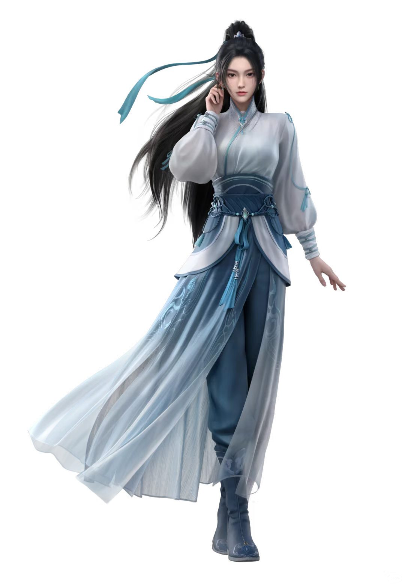

这是我经过别的大佬已经开源的漫剧skill加上自己在实际使用中遇到的情况进行了一定调整的剧本到资产到分镜到提示词的skill。

# 阿良的分镜制作规则

一句话：**剧本验收过了才进分镜，分镜验收过了才问要不要出提示词，每一份交给 AI 视频工具的东西都必须粘贴即用。**

目标模型 **MiniMax H3**（单次 4–10 秒，整数秒）。这个技能**逐件交付、每件过门**（R65）：先出剧本，你看过点头后再出人物资产，再问要不要出场景与道具资产，然后才是分镜（`分镜/镜头表.md`＋`分镜/文本分镜.md`，R70 三件套），**分镜两件确认后再问一句「要不要继续出分镜视频提示词」，你说要才写 `分镜视频.md` 并与 `项目交接.md` 同批交**（R71.1）。这一层的交付物叫「分镜视频」（原名分段视频提示词，R69），写法是 Ref2VA 六段式：第 N 段同时取镜头表第 N 行与文本分镜第 N 节，**是译写不是重写**（R66／R71）。**分镜视频的写法整份换成用户给的 `ref2va-prompt` 口径，旧 `references/分镜视频模板.md` 已删除（R71）。** 人物／场景／道具三类资产的画风也改成文字句：头三行 `画风：…（纯文字口径）`＋`画风文字：…`＋`本剧形象：…`，每条提示词正文自带整句画风（R72，纯文本生图，编号只作台账）。场景与道具不再有第二套默认：`REF-902` 已删除（R73）。**场景改两图制（1.78，R86）**：每个场景只写两条提示词——`正视图`（24mm 平视超广角全景、建筑结构完整、只一个场景）＋`俯视图`（严格 90° 垂直正上方、正交投影、无近大远小），两图都 16:9、都带图槽；不写反打、不写第三张、不写场景档案；两张都没人没字没标注。**画风默认改成两套并列（R76）**：默认一 `REF-900`「冰蓝仙侠·三维写实」（成片剧照感）、默认二 `REF-901`「冰蓝仙侠·灰底设定卡」（浅灰无缝底、平光低对比、设定卡感），用户三选一（900／901／自己上传新图）；**选「上传」就立刻暂停等图，图没到不写任何提示词**。一集只用一套默认，人物与场景道具同号。**人物提示词整条删除（1.79，2026-11-28，R28／R74／R75／R80 作废）**：人物这一层只交 `人物资产.md` 角色清单（`## Cxx`＋一句身份），不写提示词、不写图槽、不问画风，等新规则下来再补。 产出清单：

```
剧集/<EP>/剧本.md          ← 场次 + 场景站位 + 台词 + 声音设定
剧集/<EP>/资产提示词.md     ← 人物 C / 场景 S / 道具 P 编号 + 可直接用的生图提示词（一套默认画风（用户另给场景道具才第二套）各写画风／画风文字／本剧形象，R72／R73）
剧集/<EP>/人物资产.md        ← 角色清单：`## Cxx`＋一句身份（人物提示词待重设，R28）
剧集/<EP>/场景资产.md       ← 每场两条提示词：正视图（24mm 全景）＋俯视图（90° 正交），16:9（R86）
剧集/<EP>/分镜/镜头表.md    ← 六列镜头信息表（镜号与秒数／交接／空间锚与身份／钩子／逐秒指令／声音总谱）＋顶部六项自检 PASS/FAIL（R70）
剧集/<EP>/分镜/文本分镜.md  ← 全片一镜一节、十一字段、逐格四象限（R70，唯一的渲染权威）
剧集/<EP>/分镜视频.md      ← 可选件：分镜两件确认、用户点头后才写；一镜一段（分镜几镜就几段、每段只一个 [Shot 1]），六段式照 references/分镜视频/（R71）
```

## 两套默认画风（REF-900／REF-901，R76）

人物画风只问一次，三选项一次发全：①默认一 `REF-900`「冰蓝仙侠·三维写实」②默认二 `REF-901`「冰蓝仙侠·灰底设定卡」③自己上传一张新画风图（或给文字描述）。没有另给、答「默认／随便／你定／没有别的」就用默认一 `REF-900`，不再追问；**选③就停住等图，图没到不写任何提示词**。用户明确给了别的图或描述，以用户的为准。

### 默认一：REF-900 冰蓝仙侠·三维写实



- **中文质感词**：`电影级三维写实国风仙侠，半写实瓷白肌肤与细腻东亚五官，半透明多层真丝汉服，月白／冰蓝主色（深青与银灰点缀），柔和的正面棚拍光，纯白无缝背景，全身站姿，高精度布料褶皱与银饰，浅景深，无赛璐璐勾线。`
- **英文质感词**：`cinematic 3D realistic Chinese xianxia character render, semi-realistic porcelain skin and delicate East Asian features, translucent layered silk hanfu, moon-white / ice-blue palette (deep teal and silver-grey accents), soft frontal studio light, pure white seamless background, full-body standing pose, high-precision fabric folds and silver ornaments, shallow depth of field, no cel shading.`
- **英文描述**：`cinematic 3D realistic Chinese xianxia character render, semi-realistic porcelain skin and delicate East Asian features, translucent layered silk hanfu, moon-white and ice-blue palette with deep teal and silver accents, soft neutral studio key light, seamless white background, full-body standing pose, high-detail fabric folds and silver ornaments, shallow depth of field, no cel shading, no anime outline.`
- **取什么（R64：不再是「锁」）**：只借渲染质感、配色体系、材质精度、打光方式；人脸长相、身材、服装款式、姿态构图、场景地点、道具种类一律按剧情写；参考图与剧情冲突时以剧情为准。
- **场景与道具**：R73 起没有第三套默认——场景与道具默认沿用人物选的那套（900 或 901）；只有用户另给场景／道具参考才记 `REF-002`。

### 默认二：REF-901 冰蓝仙侠·灰底设定卡

灰底角色设定卡的路子：浅中性灰无缝背景、均匀柔光棚拍、极低光比近乎平光无投影，薄纱多层叠穿＋银质镂空饰件，50–85mm 中长焦全身清晰。与默认一的区别只在光与底（默认一有明暗层次、纯白棚拍，默认二平光、灰底）。三句对应写法见 `references/画风规范.md` 7.1B（人物）／7.2B（场景）／7.3B（道具）。

## 1.79 人物提示词整条删除，等重新设计（R28／R74／R75／R80 作废）

人物这一层的提示词口径全部拆掉，等用户重新给规则：

- **删掉的**：R28（人物资产四张拆三份文件）／R74（四项收三张）／R75（拆两个文件）／R80（第三份立绘文件）四块整条删除，原文与 `制作规则原文.md` 各留墓碑；规则 81 → **77 条**（空号 R28／R29／R41／R42／R68／R74／R75／R77／R80／R87）。
- **现在只剩清单**：`剧集/<EP>/人物资产.md` 一文件，每角色 `## Cxx 中文名`＋一行 `- 身份：…`（年龄／性别／剧情身份／一眼能认的特点），编号以分镜列3 出场全集为准、一个不漏。
- **不写**：提示词、`图槽：@图片 N`、张数与版式（设定卡／三视图／立绘都不出）、`画风：`／`画风文字：`／`本剧形象：` 三行头、`本集选择`、A／B 分层。
- **画风问话**降成只问场景与道具那一套（人物没有提示词，不占画风号）；`资产提示词.md` 的人物行也只留身份摘要，等新规则回来再补提示词与图槽。
- **脚本**：`check_char_assets` 改成只认 `## Cxx` 段与中文名，出现「提示词」或 `@图片` 只 WARN；旧三份文件存在时只提醒「只交清单、旧稿不回溯」。
- **同步改**：`references/人物资产规范.md` 改占位版、`模板.md` 第三节换元素清单骨架并删掉投喂参考图六条、守则 5／6／8／48 改口径、`画风规范.md` 对号与验收项去人物、`道具资产规范.md` 分层说明去人物、`出片交接.md` 角色身份锁改指清单。

## 1.78 场景两图制：正视图＋俯视图（R86）

用户给了三份文档当底：一份是通用提示词骨架《标准的全景图参考提示词》，另外两份是按它生成的成图样例（一张正视图、一张严格俯视图）。据此把场景层重新立起来：

- **每场只两张图**：`正视图`＝电影级超广角全景，24mm、平视、深景深、无鱼眼，建筑结构／门窗／家具／固定设施全在画面里，主体不许裁切，只一个场景；`俯视图`＝严格 90° 垂直正上方、正交投影，禁斜俯视／航拍透视／45° 鸟瞰、禁近大远小，完整展示场景边界与所有主要物体的位置、数量、朝向。
- **同一空间两张对得上**：正视图里看得见的门窗、道路、主体建筑，在俯视图里位置、数量、朝向一致。
- **两张都没人、没字**：人物／动物／角色不进画面；文字、水印、标志、标注、尺寸线、分镜框都不出现，方向与尺寸写进提示词正文（原 R87 的零文字红线并入这里，R87 留空号）。
- **写法固定两套模板**：正视图八段（场景构图／建筑结构／环境细节／光照设计／摄影机参数／场景一致性／画面质量／输出要求），俯视图七段（摄影机视角／场景整体布局／空间结构／视觉表现／输出规范／最终效果）；把场景具体情况替换进去，也可照样例写成整段叙述。
- **不写反打、不写第三张、不写场景档案**：尺寸、层高、门窗朝向、光位全部进正文；站位锚点仍取 `剧本.md` 的场景站位（R26）。
- **交付格式**：每场 `## Sxx 场景名` 下 `#### 正视图`、`#### 俯视图` 两节，各一条 `提示词：… ｜ 图槽：@图片 N`，两图都 16:9，图槽号接着人物资产排。

`check_scene_assets` 改查这几条：两节齐不齐（缺一节 FAIL）、每条有 `提示词：` 与 `图槽`、都写 16:9、正视图写全景与 24mm／广角、俯视图写 90° 与正交、两张都写明不出人物；出现「反打」即 FAIL，还留着场景档案只 WARN。规则 80 → **81 条**（R86 重新启用，空号 R29／R41／R42／R68／R77／R87）。

## 1.77 场景提示词整条删除，等重新设计

用户要求把场景提示词这一层全部撤掉，等他给新的一套规则。做了三件事：

- **删规则**：`SKILL.md`／`references/制作规则原文.md` 里 R77（每场三张 16:9）、R86（三张同一空间）、R87（俯视图零文字）三块整条删除，各留一句 tombstone「2026-11-28 整条删除，待重设」；条数 83 → **80**（空号 R29／R41／R42／R68／R77／R86／R87）。
- **改交付**：4.2 第 4 步「出场景资产」保留门位，内容缩成**只出档案**——`场景资产.md` 写 `## Sxx` 编号＋场景档案（基础资料／文字描述／世界观／空间尺寸／空间坐标／光照与天气／材质／固定空间规则与轴线），**不写提示词、不写图槽、不问画风**；`references/场景资产规范.md` 整份改成占位版，只留这两样。
- **收检查**：`check_scene_assets` 从「三张齐／16:9／空景／反打 180／地标重合／俯视图字符」六大组检查，降为「有场景段、每段带 `Sxx` 与场景档案」；写了提示词只 WARN（提示口径已删）。`模板.md` 场景段换成档案版，守则 54／55 删除、新增 56「场景提示词待重设」。

新规则下来后按新编号（R86 起或沿用 R77）补写，`场景资产.md` 再把提示词与图槽接回去。

## 1.76 俯视图画面里一个字符都不许有（R87）

俯视图是纯图形平面图：墙体、门窗开口、家具轮廓、通道、锚点物线圈。画面里**不出现任何文字**——房间名、尺寸数字、字母编号、图例、水印、标注气泡都不行；方向箭头那类「↑ 主入口方向」「上为北」也不许画，方向只在提示词正文或场景档案里用一句 `本图方向：画面上方为主入口，左为东` 说清。

锚点物改细线框／虚线框／色圈区分，不挂文字标签；家具靠位置与形状区分，不靠字母编号。俯视图提示词固定写 `画面内无任何文字、无数字编号、无箭头标注、无水印`。

`check_scene_assets` 查俯视图提示词：出现 `↑`／`主入口方向`／`上为北`／`文字标注`／`房间名`／`图例`／`尺寸标注` 即 FAIL；没写「无文字」只 WARN。

## 1.75 场景三张是同一个空间的三个机位（R86）

场景资产的三张图不是三张「差不多好看的场景」，是**同一个环境**的俯视、正打、反打。判据是六同：同一场景名、同一墙面与地面材质颜色、同一门窗数量与位置、同一家具清单与摆位、同一道具与锚点物、同一光位时段与色调。三张都写同一句锚句：

```text
空间锚：<场景名>｜门：画左/画右 …；窗：…；主桌：…；床：…｜<光位与时段>
```

落到检查上：`check_scene_assets` 抽三张的地标词（门／窗／桌／床／墙／柜台／碑／石阶…，外加「X 在画左／在画右」抽出来的名字），**正打与反打至少 2 个重合、俯视图与任一视角至少 2 个重合**，否则 FAIL「三张不像同一空间」；三张都没写「同一空间／同一场景」只 WARN。反打拍成另一个房间、一张雨一张晴、三张各写一个场景名，都按不合格算。

## 1.74 清理：三条被取代的老规则删成空号

规则只增不删会越堆越乱，这次把**正文已被新版完整取代**的三条整块删掉，编号留空号，指向它们的旧引用统一改写成新号：

| 删除 | 原文口径 | 现由谁承 |
|---|---|---|
| R29 | 场景资产十章 A／B（01–04 归 A、05–10 归 B） | R77 场景三图制（俯视图＋正打＋反打，16:9） |
| R41 | 道具 A＝主视觉＋三视图＋状态变化、B＝局部细节＋材质＋使用交互 | R78 道具一件一张白底图 |
| R42 | 写剧本的同一轮就把三类资产提示词一起写出来 | R65／R85（六件五门、资产后置） |

R17（4–15 秒）与 R31（唯一默认 `REF-900`）、R51／R53（旧分镜视频口径）这次没删：它们正文早已按 R79／R76／R71 改写，删了会丢活口径（R31 的看图五件事、R51 的密度、R53 的英文骨架都还在用），只把条内的旧句子修干净。

规则条数从 84 条降为 **81 条**，空号 R29／R41／R42／R68，编号一律不回收、不重排。

## 1.73 新口径：三份资产挪到分镜之后（R85）

先出 `分镜/镜头表.md`＋`分镜/文本分镜.md`，再照分镜列3 的**出场全集**写人物资产、场景资产、道具资产。原因很实在：先写资产、后写分镜，分镜里临时加的群演、临时挪的场地、临时加的道具就会没有对应提示词；后置之后，分镜就是清单，资产照单写全，一个不漏。

分镜这一步只分配 `@Cxx`／`@Sxx`／`@Pxx` 编号与中文名（跨集只顺延），**不写图槽、不写资产提示词**；图槽 `@图片 N` 在三份资产落盘时才定，分镜视频最后写、直接用资产里的槽号。交付顺序变成六件五门：剧本 → 分镜两件 → 人物资产三份 → 场景资产 → 道具资产＋资产提示词 → （问一句）→ 分镜视频＋交接。

## 1.72 新口径：提示词以镜头表为主体（R84）

写 `分镜视频.md` 时，**镜头表是主体，文本分镜只是细节补充**。第 N 段的骨架——镜号与时长、承接与交棒、锚点与身份、钩子、列5 逐秒（景别＋画面句、运镜、动作链、表情、光效）、列6 台词与声音——全部从镜头表第 N 行来；文本分镜同节只补镜头表没写的可见细节（视线落点、手部与接触点、道具状态、皮肤衣料、环境层次、情绪刻度、构图草图），**不加动作拍、不加台词、不加道具、不加镜头**。两处冲突一律以镜头表为准；镜头表本身有错，回分镜层改，不在提示词层私自修正。

## 1.71 新口径：连续动作链可以给 4 秒（R83）

「人物走进来、在凳子上坐下、手放桌上、用指节敲桌面」这种**两个以上不同动作首尾相接、完成一件事**的连续动作链，整条链给 **4 秒**；孤立单个小动作（抬手、点头、转身半步）仍只占 1–2 秒（R81）。链的写法：第一格起势或入画，中间每格推进一个新状态、不重复同一动作，最后一格收在完成态并停住，不许切在链中间；同一动作连写 3 格以上就退回 1–2 秒。镜 5–10 秒时，链之外的秒格给停顿、反应、环境，不许继续写动作。

## 1.70 新口径：镜头不许只写名字（R82）

《短剧镜头全典》69 条整份融进技能（`references/短剧镜头全典.md`：名称／档位／作用／说明／画面六表＋配比＋时长参考）。写分镜列5 时，**不许再只写「近景、平视、固定」这种名字**，要照全典「画面是什么样」那一栏，把这个镜头落到**当前这一场、这一镜的具体画面**：谁在画左画右、前景压着什么虚影、占画面多少、看得见什么、看不见什么；再写机位高度与角度、一种运动、这一镜的功能（定场／关系／正反打／反应／插入／钩子特写等）。镜头名是分类，画面句才是提示词能用的东西。

## 1.69 新口径：普通小动作只占镜内 1–2 秒（R81）

没有台词、没有打斗、没有特效的镜里，抬手、递物、转身半步、起身、坐下、推门这类普通小动作在镜内只占 **1–2 秒**：列5 逐秒里只占连续 1–2 个秒格，第 3 格起必须换成维持／停顿／情绪／视线／环境。镜长照旧 4–10 秒（R79）——省下的秒格给停顿，既不许把镜压到 1–2 秒，也不许为一个抬手把镜拉到八九秒。说话按台词区间、打斗按拍数，两者不受此限。

## 1.68 新口径：人物资产再加一张全身立绘（R80）

人物资产在原有三张基础上再出第四张 `A4 人物立绘`，单独一份文件 `人物资产-立绘.md`：每角色一张、单人、头顶到鞋底完整入画、站姿、竖构图 3:4、浅中性灰或纯白无缝棚底、脚下一层极淡接触影；写全脸（与 A2 同一人）、发型发尾、整套服装与鞋与配饰、头高与肩宽／腰线／臀位／腿长。一张图只一个人，不并排、不群像、不持道具、不做九宫格多姿态。一个角色从此四个图槽（设定卡／面部半身／服装三视图／人物立绘），三份文件角色号一一对上。

## 1.67 新口径：单镜硬区间 4–10 秒（R79）

单个分镜最短 4 秒、最长 10 秒，整数秒；4 与 10 可用，3 与 11 都不许。不足 4 秒在分镜层并进相邻镜；超过 10 秒在分镜层拆成两镜，拆点落在动作能停住的拍子上，不许平均切、也不许靠镜内 `[Shot 2]` 续时。一段＝一镜，所以段长同样是 4–10 秒整数，镜长与段长逐字相等；一集仍 220–260 秒，按 4–10 秒排约 22–65 镜。自检：任一镜 <4 或 >10 秒即 FAIL。

## 1.66 新口径：道具一件一张白底资产图（R78）

场景资产不再按十章出，也不再分 A／B、不问层。**每个 `## Sxx` 只有三张图提示词**：

1. `俯视图`：正俯视 90°（必要时 85–90°）空间俯视图，墙体与门窗开口、家具占地与尺寸、通道净宽，锚点物细线圈出，右上角方向箭头；
2. `正打视角`：空景，机位在轴线一侧、高 1.4–1.6 米、24–35mm，朝场景主表演区拍，写清画左画右；
3. `反打视角`：同一场景、同一轴线、反方向 180°，焦段与机位高度同正打，画左画右与正打左右互换且一一对得上，光位同一档。

三张都写 `16:9 横构图`（用户指定别的比例就三张统一改），都是可粘提示词带 `图槽：@图片 N`；场景档案（资料／尺寸／坐标／光照五档／天气四档／材质／轴线与连续性）写成可核对句、不配图。旧的场景全景图／正面／侧面／背面视图、平面布局图、建筑／门窗／墙面／地面细节图一律不再出。

## 场景与道具默认画风（同人物那一套，R73／R76）

场景与道具画风也只问一次：另给图／文字 → `REF-002`；说「沿用人物那张」、没有另给、或答「默认／随便／你定／没有别的」→ 同人物号（900 或 901），不再追问；说「换另一套」则在 900↔901 之间整套换。`REF-902`「雨雾仙侠·实景质感」与两张场景预览图已在 1.61 删除，全片只用一套默认。

- **场景画风文字（默认一 REF-900，照抄即可；默认二换 7.2B 句）**：`电影级三维写实国风仙侠实景，半写实材质细节，低饱和冰蓝与月白主调、深青与银灰点缀，柔和天光与薄雾、空气透视、远处随景深压灰，真实物理材质——青石、旧木、夯土、青苔、湿布都写湿润粗糙的哑光表面与颗粒，边缘带使用磨损与污渍，受光面有微弱反光、背光面沉下去，24–35mm 广角、略低机位、浅景深，无赛璐璐勾线、无描边`。
- **道具画风文字（默认一 REF-900，照抄即可；默认二换 7.3B 句）**：`电影级三维写实国风仙侠道具特写，半写实材质细节，低饱和冰蓝与月白主调、深青与银灰点缀，真实物理材质、金属木布陶玻璃各写反光与粗糙度，表面带使用磨损、磕痕、指纹与旧渍，柔和侧上方主光加一侧弱轮廓光，纯浅灰或纯白无缝背景、单件居中、无投影遮挡，浅景深、50–85mm 微距质感，无赛璐璐勾线、无描边`。
- **取什么（R64）**：同一套三维写实质感、低饱和冰蓝月白＋深青银灰、湿润粗糙的材质语言、柔光与浅景深；具体是村落还是山河、桌上摆什么道具，一律按剧情写。

## 它和我改了什么

- **分镜视频层换成 Ref2VA 规范（R71，1.59 起，取代 R56 旧骨架）**：分镜两件确认后**先问一句**「要不要继续出分镜视频提示词」，用户说要才写 `分镜视频.md`，说不要就停在分镜、不生成、不判缺、不写「待补」。写法＝**双源取料**＋**六段式**：第 N 段同时取镜头表第 N 行（列1 秒数／列2 交接／列3 锚点与光／列5 逐秒／列6 台词与声音）与文本分镜第 N 节（十一字段、逐格、视线与道具格）；六段顺序 `subject_definitions`／`summary`／`retention_analysis`／`detailed_description`／`overall_soundscape`／`non_diegetic_music`，`summary` 方括号任务类型开头，`retention_analysis` 四档标记、一项一行带 `(appears in [Shot 1])`、不写 `(Sx)`，正文 350–500 英文词、风格句在 `[Shot 1]` 之前，台词 `<d>[Chinese] 原文</d>` 逐字一句一处。四份细则见 `references/分镜视频/`（六段规范／镜头语法／取料对照／六段模板）。旧六行元数据（时长／场景与轴线／表演参考／标签映射）、图片中文名注记、outside witness 固定长句、`Entry:`／`Exit:`、150–350 词全部作废。
- **画风必须写成文字（R72，1.60 起，纯文本生图口径）**：用户走纯文本生图，参考图与 `REF-xxx` 编号对模型不可见，所以三份资产与 `资产提示词.md` 的头三行改成 `画风：REF-900 冰蓝仙侠·三维写实（纯文字口径）`＋`画风文字：<一整句>`＋`本剧形象：…`（场景道具那套写 `画风：同人物（REF-900）`，R73）；每条提示词正文必须自带整句画风文字，至少四维：渲染媒介（三维写实／写实）、配色（低饱和冰蓝月白＋深青银灰）、材质（哑光真丝／湿润粗糙石木／金属磨损）、光与镜头（柔光无反差／薄雾／浅景深 85mm／纯白背景）。`参考画风 REF-xxx（取其××，形象按本剧）` 尾巴只作台账；正文不许写 `见参考图／同上／按参考图` 这类指代。三句默认画风文字与五维清单见 `references/画风规范.md` 第七节。
- **时间码分两层（R13–R15／R18／R71.7）**：**分镜层不写绝对时间码**，镜头表按「秒」逐条写（列1 写 `镜 1-3 / 6s`）、文本分镜按逐格时间码；**分镜视频一镜一段，段内只一个 `[Shot 1]`、不写 `At MM:SS.mmm`**，段长写在段标题（`## 第 N 段 ｜ 镜 N-M / Ns ｜ 镜名`）。只有用户当次明确要求多镜合成一次生成时，才允许 `[Shot 2] At MM:SS.mmm`。`check_rule.py` 分镜查 `check_no_timecode`，分镜视频查 `check_one_shot`。
- **六段与四类标签（R71.2／R71.3）**：六段顺序固定，六段前不许加中文约束段；`<Subject N>` 装可见内容（`<Subject 1> is 修士甲 (C04), …`），`<Picture N>` 只装当帧用的图（首帧／尾帧／关键帧／构图锚点），只定义长相与场景的图折进 Subject、不单独立项；没有参考音频不出现 `<Audio N>`；一镜一段一般不出 `<Video N>`；没有视频输入不写 `video continuation`。正文可以写中文专名，叙述用英文。
- **参考图只继承身份，不继承正脸与视线（R54／R71.9）**：参考图同时带身份（五官、发型、服装、体态）与画面（取景角度、头部朝向、视线、姿态），写作时只继承身份，画面信息由分镜重新指定；旧的 `The reference supplies … only;` 与 `main orientation` 固定句作废，主体定义句写成一句自然的英文描述即可。近景／中近景写 `pupils off the lens axis`；机位优先过肩／三分之二侧／侧面／背面；同一主体参考图≤3 张且上传顺序与编号一致。
- **提示词方法论吸收（R55）**：复杂接触、拥抱、比武、兵器咬合、多人身体交叠、训练素材里少见的姿势，先在分镜指定关键帧再进分段；动作写成「谁施力→作用到谁→出现什么结果」，不许三条并列属性；形容词堆不出画面时换通用视觉概念或「具体动作＋定性词」，但禁用具体 IP 角色／演员／导演／品牌名作比；每镜先写人站哪、朝哪、起始动作，再写机位；披风／衣袖／头发写人物侧＋机位侧两套参数；具体动作之后才补定性词。投喂给模型的参考图必须单脸、短边≥1024、纯色背景、均匀柔光、中性表情、脸身分开，同一主体仍≤3 张；生图提示词不写「不要模糊／不要畸形／不要多余手指／8K／超清／大师之作／质感拉满」，H3 分段的英文否定约束句保留；远景认脸改用近景或单脸图；器材只写效果，不写品牌、机身、三脚架。详见 `references/提示词方法论.md`。
- **人物绝不对视镜头（R52／R71.9）**：镜头可推近拍脸、拍眼睛、给特写，但人物的眼球、瞳孔、目光不许对准镜头。每一处写脸或眼睛的句子写清 eyeline 落点（对手的脸／手、门缝、剑柄、石阶、远处窗口），近景与中近景写 `pupils off the lens axis`。旧的 `An outside witness records … No subject looks into the lens …` 固定长句作废；禁写 look into the lens／look at the camera／meet the camera／first-person POV、看向观众。`check_rule.py` 的 `check_camera_gaze` 查看镜头措辞，`check_segment_gaze` 只提醒 eyeline 与瞳孔。
- **分镜视频不是分镜缩写（R51／R71.6）**：`分镜视频.md` 是直接贴给 H3 的成稿，不许只剩「切镜＋台词」；分镜里的动作、表情、光、声音、道具一项不许少，动作到关节／肌肉／承重，表情到眉／眼／嘴／下颌／喉／呼吸，正文 350–500 英文词。台词进 `<d>[Chinese] 原文</d>`、逐字、一句一处；身份、`(Sx)`、语气写在 `<d>` 外；画外音与独白跟一句闭唇。环境声与动作声写进 `overall_soundscape`，配乐只放 `non_diegetic_music`（默认 `N/A`）。
- **场景与道具默认画风（同人物 REF-900，R73，2026-11-28 改）**：删除 1.42 起内置的 `REF-902`「雨雾仙侠·实景质感」与两张场景预览图，场景与道具默认改用人物那套 `REF-900`（同一套渲染、配色、光与镜头）；第二问仍只问一次，另给记 `REF-002`，沿用或没有就同 `REF-900`。`画风规范.md`、`SKILL.md` R31／R35／R47、自检 19／23、`模板.md`、`制作规则原文.md`、`check_rule.py` 同步。
- **只有镜头去找人物，没有人物去找镜头（R49）**：机位在画外主动观察，可以推近、拉远、绕到侧面、从背后拍；人物不知道镜头在哪，也不因镜头出现改动作。人物视野不得与镜头发生关系——不直视／看向／望向／对着／盯住／锁住／找／迎／追镜头，不朝镜头演、不对镜头笑、不往镜头撞、不把脸转向镜头；每个人视线必须有落点（对手的手、门缝、剑柄、桌面、远处窗口、地面血迹）。分镜三层与分段动作句都守，资产图除外。
- **分镜提示词按动作顺序写细（R50）**：每镜从「起幅：」起连续写，不写时间码；每个动作句写全七件事——谁＋锚点方位＋朝向与机位景别＋关节肌肉承重＋情绪与表情肌肉＋视线落点＋道具/光。台词单独占行，插在说话发生的那一步之后；不许「他看着」「她笑了」「气氛紧张」；任一动作句少于 15 个汉字就退回重写，`check_rule.py` 会报「提示词过短」。分段层按官方 Ref2VA，首镜无时间码、后续镜 `At MM:SS.mmm`，详细规则见第 20／21 条。
- **表演参考按角色对号（R48）**：`references/表演参考/` 收了四套资料——微表情 36 条（哭 6／笑 5／综合 25）、镜头与光影（景别 7／构图 6／运镜 11／光 11／转场 7）、动作与肢体（8 类＋手部 10 式）、分镜与场景（宫格／60 秒与 90 秒骨架／现代 10／古装 10）。参考库只是参考：先判断这个角色、这个情境会不会这样做，会就取它的肌肉顺序与节拍，改写成这个角色的具体动作、幅度、速度与破功点，写进分镜或分段动作句；不会就换一条或自拟。不整条照搬、不贴条目名、不一套模板套所有人；交付报告写「参考命中／参考未覆盖」。参考不改 4–10 秒段长、220–260 秒一集、九栏、不写时间码、台词与不配乐；资产图不受限。
- **人物与场景道具各问一次、各有默认（R47）**：人物画风只问一次；另给图记 `REF-001`、只给文字记 `REF-000`，没有另给就用默认 `REF-900`「冰蓝仙侠·三维写实」，不再追问。场景与道具也只问一次；另给记 `REF-002`、说沿用就同 `REF-900`，没有另给就同人物 `REF-900`（`REF-902` 已删除，R73），不再追问。人物与场景道具同挂 `REF-900`，另给场景道具参考才用 `REF-002`。原 41 条内置画风库仍不恢复。
- **选定题材照五项写（R46）**：21 个题材各有「节奏／对白字数与开口占比／台词口径／进度字段／内容尺度」五项，选定后就按该题材写；剧本头部写 `题材：Txx`、`对白≥X 字·开口≥Y`、`进度行：…`、`本集尺度：…`，末尾用 `本集对白：XXX 字（开口 YYY 字）` 对账；速查表在 `SKILL.md`。
- **尺度口径（1.27 起）**：血腥、暴力过程不设上限，剧本与分镜按剧情写足动作与结果，画面打码交后期剪辑；迷信设定按剧情需要写，不再要求「人为真相／不写仪式」。仍保留未成年、亲密、真实影射、可模仿手法、自伤这几条红线。
- **资产覆盖率核对（R44）**：剧本／分镜／分段里出现的每个 `@Cxx`／`@Sxx`／`@Pxx` 在资产表必须有条目，缺号即补、多余的标「未使用」；`check_rule.py` 已内置这条核对，再逐场人工过一遍临时道具。
- **项目交接文档（R45）**：第一遍四件套跑完生成项目根 `项目交接.md`，写小说改到第几章第几段、集间承接、已产出资产表（编号／层／图槽／状态）、画风锁与待办；下一集先读它，已有资产不重复生成。
- **一个画面多角色，情绪各写各的（R43）**：每个角色单独写情绪＋自己的肌肉与肢体；1 号开心、2 号不爽，2 号不许照抄 1 号的眉眼嘴角；情绪不同至少三处身体落点不同，同情绪也按人设写微差（幅度、快慢、藏不藏、破功点）；分镜「表情」多人分列一人一行，分段同一画面可写两人不同情绪，禁「众人惊讶」。
- **剧本同批出三类资产，但不入剧本（R42）**：落 `剧本.md` 那轮同时写 `资产提示词.md`（人物／场景／道具三节）与按需的人物／场景／道具资产文件；剧本正文只留 `@C01 周野`、`@S01 出租屋 · 门`、`@P01` 引用；场次 `EPxxx-SCxxx`、C／S／P 两位编号三层通用，分段每段也用同一套编号与 `@图片 N`。
- **情绪词必写，再落身体（R5）**：先一句情绪（什么情绪、几成、冲着谁），再写它长在这具身上的肌肉与肢体；剧本、分镜「表情」、分段「提示词」三层同序，不许只剩动作流水账。
- **全场景一个锚点（R26）**：同一场景所有人相对同一个不动之物写「离锚点多远、朝哪边、哪只脚承重」，剧本／分镜／分段一字不差。
- **场景资产固定三张图（R29／R77，1.65 起）**：每个场景只出 `俯视图`＋`正打视角`＋`反打视角`，默认 16:9；正反打同轴反向、左右互换对得上；场景档案是文字、不配图；不再问「场景先出 A／B／AB」；道具一件一张白底图（R78）。
- - **人物提示词整条删除、待重设（R28／R74／R75／R80，1.79，2026-11-28）**：人物这一层本轮只交 `剧集/<EP>/人物资产.md` 一份角色清单——每角色 `## Cxx 中文名`＋一句身份（年龄／性别／剧情身份／一眼能认的特点），编号以分镜列3 出场全集为准、一个不漏；不写提示词、不写图槽、不问画风、不分层、不写 `本集选择`。旧的「每角色四张（设定卡／面部半身／服装三视图／立绘）、拆三份文件」全部作废，旧稿按不回溯保留、脚本只提醒；新规则下来后按新规则补提示词层。
- **视频反推：给视频 + 说「反推」，先交两份再问一句（R58，1.45 起；1.59 起分镜视频可选）**：用户给一段视频并明确说「反推」，先只出 `分镜/镜头表.md` 与 `分镜/文本分镜.md`，不出剧本、资产、项目交接，也不问题材与画风；问一句要不要提示词，要了才出 `分镜视频.md`。写法是逐镜复刻原片：镜数、镜序、时长、景别、机位高度、运镜方向与速度、构图、站位朝向、动作起止与承重点、表情与视线落点、光位与色温、台词句数与口型段、环境声与动作声一律照原片，不合并、不拆分、不补镜、不改词。**没有实拍资产图，图槽一律写占位种类名**：`人物一`／`人物二`、`场景一`／`场景二`、`道具一`／`道具二`（按出场顺序顺排、全片固定同号、只顺延不回收），写成 `@图片 1 人物一（空缺占位）`／`<Subject 1> is 人物一, …`，**不编 `@C01／@S01／@P01` 真编号、不写「已出图」**。听不清的台词写 `<d>[Chinese] [unclear]</d>`。原片用了黑场／叠化就照写（R57 禁令的唯一例外）。细则见 `references/反推规范.md`。
- **有特效的场面照特效模板写（R59，1.46 起）**：小说或剧本里出现法阵／阵法、能量体（能量手、光柱、光索、剑气、法相）、元素异象、法器活化、变身与状态、天象与空间任一类，三层一律照 `references/特效模板.md` 写，不再各写一套。剧本层一场 1–4 个特效、一行一个 `[VFX] 名称｜形态｜光源｜起｜中｜收`，形态写材质颜色与内部结构、边缘处理、体积透明度，光源写照亮谁与投影朝哪，起中收各一句且收停在可截帧的稳定态；再一行 `[LIGHT]`、`[SFX]` 一特效一行写三层声音（低频底／瞬时声／余响，不写配乐）。分镜层场标题括号列本场特效清单，同一特效落进「动作／动作先后／自然规律／提示词」四处，提示词按起→中→收三个可见阶段逐句写，一句一阶段。分段层每个 `[Shot N]` 句用分号串阶段、颜色材质与光向英文词必须在句子里，纯光效不占 `<Subject N>`，术语全片固定（`rune formation`／`rune`／`light pillar`／`arc`／`matte black`／`ward`…）。形变类特效写「几拍开始变 → 变成什么 → 变完停在哪」；转场优先用特效做桥（光影过渡／动作匹配／遮挡转场）。九栏与 Ref2VA 六段不动，不新加栏目；R39 是底线、这份模板是成品标准。自检脚本会查 `[VFX]` 五段缺段、禁用词、`[SFX]` 少于 `[VFX]`、特效名没落进分镜场块、分段没有特效英文词。
- **镜与镜、段与段之间必须写转场（R57，1.44 起；1.59 起分镜视频部分改写）**：镜头表每行列2 交接栏写清「承接：上一镜末帧的姿势／重心／手持物／朝向／光位」与「交棒：下一镜要接的那一拍」；分镜视频不写 `Entry:`／`Exit:`（R71.8 已作废），改在 `[Shot 1]` 正文里：**第一句承接上一段末帧**、**最后一句停在可截帧的静止点并写清交给下一段的那一拍**。方式六选一——同向运镜、动作匹配、遮挡转场、出入画跟随、光影过渡、跨场硬切；**禁用黑场、闪白、叠化、淡入淡出**（只有用户当次点名才写），不许越轴、遮脸遮嘴、拦腰打断台词。同一种转场连用不超过 3 次，遮挡一集不超过 3 次。`check_rule.py` 出现旧标签只提醒。
- **段与段之间要么无缝、要么写明看得见的转场（R60，1.47 起；1.59 起改由首末句承担）**：每一对相邻段只有两种合法接法。**A 无缝接**（同场、机位方向没变、前段末帧与后段首帧是同一动作的连续相位）：后段 `[Shot 1]` 第一句直接从上一段停住的那一拍起，不加转场画面。**B 显式转场**（换场、时间跳跃、必须换轴线）：首句写 `hard cut to <新场名>` 或一个看得见的转场动作（甩镜／前景遮挡／推入虚焦／光效吞满／同侧走出再走入），只写 `hard cut` 不算。剪辑点不许切在说话中途、表情变化中途、半个动作上；同场优先 A，一集 B 不超过段间一半，同种 B 连用不超过 3 次。`check_rule.py` 不再查 `seamless`／`Transition out:` 标签，只提示人工核对。
- **分镜视频一镜一段：分镜几镜就写几段（R63，1.50 起；1.59 起段长写段标题）**：镜头表第 N 镜就是 `分镜视频.md` 第 N 段，**段数＝镜数**；段标题 `## 第 N 段 ｜ 镜 N-M / Ns ｜ 镜名`。每段只放一个 `[Shot 1]`，**不许出现 `[Shot 2]`／`At MM:SS.mmm` 段内切点**——想切镜就回分镜加一镜、分镜视频跟着多一段。段长逐字等于该镜镜长，镜长与段长统一 **4–10 秒整数**；不足 4 秒的短镜在分镜层并进相邻镜，超过 10 秒的长镜在分镜层拆两镜。`check_rule.py` 的 `check_one_shot` 查段内多 `[Shot]`、段数≠镜数、段标题镜号或段长≠镜长为 FAIL。
- **有对话与人物表情的场面照表情台词模板写（R62，1.49 起）**：剧本在场头写 `**说话顺序**：① 甲 → ② 乙`（独白标 `（VO 不张嘴）`），台词一句一行只写 `说话人：原文`，每 1–4 句之间插一句身体准备，表情两层（情绪＋几成＋对着谁｜眉·眼·鼻·嘴·颈·手），末尾写 `## 声音设定` 与 `## 表演总则`。分镜「台词」/列6 写次序与原文（R70：原文只在列6 出现一次）；分镜视频里每段有带几成的英文表情句，说话镜与听者镜口型分开写（`lips opening on the first word`／`lips closed, only eyes and jaw react`），台词一律进 `<d>`。
- **三类资产取消画风锁，改成参考画风（R64，1.51 起；1.60 起画风落成文字句，见 R72）**：`人物资产.md`／`场景资产.md`／`资产提示词.md` 的头两行从「画风：REF-… 画风锁」改成 `参考画风：REF-900 冰蓝仙侠·三维写实（参考，不照搬）`＋`本剧形象：…`；每条提示词先写这个人在剧情里的样子（身份年龄／体型姿态／服装款式与磨损与伤势／发式与固定特征，场景写建筑与年代痕迹、天气与使用痕迹，道具写形状尺寸材质磨损），再写一两句质感词，尾巴写 `参考画风 REF-…（取其××，形象按本剧）`。只借渲染质感／配色倾向／材质语言／打光方式，人脸长相、身材、服装款式、姿态构图、建筑布局、场景地点、道具种类一律按剧情写；参考图与剧情冲突以剧情为准；换参考图只换编号与质感词、本剧形象一字不改；一套形象、两套参考（人物 `REF-900`，场景道具同用 `REF-900`，R73）。
- **每一件产出物都要用户点头，才做下一件（R65，1.52 起）**：顺序固定 `剧本.md` →（确认）→ `人物资产.md` →（确认）→ 问「要不要出场景与道具资产」→ `场景资产.md`＋`道具资产.md` →（确认）→ `分镜.md` →（确认）→ `分段视频提示词.md`＋`项目交接.md`（同批）。每写完一件立刻 `present_files` 交付、只给一张小表、末尾给「继续／改这件／停」三选项；不许顺手做下一件、不许预告下一件内容；「看看合不合适」不算放行。跳过剧本（R33）只免第一道门；反推（R58）两份同批、不受四道门约束。
- **交付物改名叫「分镜视频」（R69，1.56 起）**：文件名 `分镜视频.md`，模板 `references/分镜视频模板.md`；里面仍是一镜一段的「第 N 段」、六段式与元数据不动；产出清单、交付表、`项目交接.md`、目录树一律写新名。旧名 `分段视频提示词.md`／`分段模板.md` 作废但兼容——脚本先找新名，找不到再读旧名并在 WARN 里提示换名。R56／R60／R63／R66／R68 里写的「分段」「分段层」，一律读作「分镜视频」「分镜视频层」。
- **分镜改成「六列镜头表 → 六项自检 → 文本分镜」三件套（R70，1.57 起，取代九栏与陈述句体）**：分镜这一件＝`分镜/镜头表.md`＋`分镜/文本分镜.md`，两份同批交。镜头表六列固定——`Shot ID & Duration`（镜号 `镜 1-3 / 6s`）／`Continuity Handoff`（从上一镜怎么长出来、怎么给下一镜开口子）／`Reference Anchors (Spatial + Identity)`（固定地标＋屏幕位置／角色位置与朝向／离场角色／光照基线＋`@Cxx @Sxx @图片 N` 绑定）／`Hook Type`（setup／reveal／reversal／callback／suspense／tender／chase／visual-joke／expression-beat／climax）／`Shot Description (Per-Second Directives)`（镜头层＋**逐秒指令**：每秒五要素齐——动作姿态表情／镜头运动／空间与道具／音频（静默也写）／向下一秒的交接）／`Audio & Dialogue Track`（旁白／对白原文＋语气＋时间区间／音效锚点／表演提示）。**六项自检门**：钩子密度（连续三镜至少一个 reveal／reversal／callback，首末镜强钩）／单镜 4–10 整数秒／单镜有动作或有台词的角色 ≤3／空间锚继承（地标与光照延续，偏移写原因）／逐秒覆盖（条数＝秒数）／跨镜连贯链（列2 连读成一条画面链）；六条逐条 PASS/FAIL 写在表顶，不过就整轮重跑。文本分镜一镜一节、十一字段（镜标题与时长／钩子／场景与角色／空间锚卡／连续性／双重绑定／逐格四象限／版式／逐格绑定／ASCII 草图／标记），一秒一格，是唯一渲染权威。**台词原文只出现一次——写在镜头表列6**，列5 只写开口、文本分镜只写 `mouth-open: 谁`。人物不看镜头、一集 220–260 秒、4–10 秒整数镜、编号与图槽、只出提示词不出图照旧。旧九栏体与陈述句体只读不写；`check_rule.py` 新增镜头表校验（六列、自检六条、逐秒条数、钩子词表、台词只在列6、十一字段与逐格覆盖、镜号格式），旧格式只提醒不判错。
- **旧分镜（1.58 已删除）**：九栏体与陈述句体的 `分镜.md`、样例、模板骨架、脚本旧解析全部撤掉，不再接受、不再提示、不再判错；手上旧稿要接着做就按 R70 重写。
- **分镜写成陈述句体（R68，1.55 起，1.57 由 R70 取代，1.58 删除）**：每镜标题 `### 镜头 N-M ｜ 小标 ｜ N 秒`（镜长写标题里，分段靠它取段长），正文 1–4 段普通陈述句，按「环境与光 → 人物怎么动（先动哪只手哪只脚、重心怎么移）→ 表情几成、冲着谁、眉眼嘴怎么动、视线落在哪 → 光与声的余韵 → 台词怎么说（`他说：「原文」`＋语速／音量／尾音）→ 这一镜多少毫米什么景别、机位几米、略仰略俯、固定还是推近 → 画面停在……」走；九栏内容一样不能少，只是不再用 `- 拍摄手法：` 这类标签罗列（旧稿九栏体不回溯）。样例：`references/分镜陈述句体样例.md`；`check_prose` 逐镜检查镜头规格／俯仰／运镜／景别／表情几成与肌肉／视线／说话方式／镜长／末帧九项（只提醒）。
- **分镜是全信息稿，分段只译（R67，1.54 起）**：分段用得上的每一样，先在 `分镜.md` 里写完——「表情」栏五段齐（情绪＋几成＋对着谁｜眉·眼·鼻·嘴·颈·手）且末句写视线落点，哭／怒／惊／痛的破功点写进「提示词」动作句；台词原文写进该镜「提示词」`角色（情绪＋语速＋音量＋尾音＋音色不变）：原文`，说几句写几行，「台词」栏仍只写 `① 名`，独白标 `（VO 不张嘴）`；打斗镜「动作」栏首句先写 `回合 N｜谁先动｜接触点｜结果`，再写起势→接触→受力，一镜一回合、每击落中文可见结果（兵刃咬死／被震退半步／甲片裂开），受力英文术语留到分段；带光效的打斗在同一镜「提示词」按 起→中→收 写光效，`转场出：` 末帧写清火花／尘／光衰减档位。**分镜没写的，不许在分段层现编——回去补分镜。**自检 `check_board_full` 查台词行、回合三段、表情肌肉三件（只提醒，旧稿不回溯）。
- **分段是把分镜译成 H3 语言，不重写（R66，1.53 起）**：第 N 段只从 `分镜.md` 第 N 镜的九栏取料——`拍摄手法`→`[Shot 1]` 冒号前的景别／机位高度／角度／轴线／运动＋`* 场景与轴线`；`动作`／`动作先后`→英文动作链，拍数不减（①第一分句、②`then`、③`as`）；`表情`→英文表情三句含「几成」；`自然规律`→光位、投影、雾、水痕、白气；`声音`→`overall_soundscape`（不抄台词）；`台词`→`(Sx) 角色：[Chinese] 原文` 逐字；`参考图`→图槽与 Subject；起幅与 `承接：`／`转场出：`→Shot 句开头／`Entry:`／`Exit:`。**四不许**：不许新增、删减、替换分镜没有的动作／台词／道具／镜头，不许两镜并一段。**不译「理由」**——「略仰＝让大旗与甲胄压住他」只写可见结果 `the slight low angle lets the banner and the massed armour loom behind him`，英文正文不出现 `because`／`so that`／`in order to`。不动机位与镜长，术语全片同一个说法；交付前逐段拿九栏对账。

- **有打斗的场面照打斗模板写，带光效就叠特效模板（R61，1.48 起）**：兵器对打、徒手格斗、群战围攻、追击截击、受击与击飞、一击定胜负、起势对峙任一类出现，三层一律照 `references/打斗模板.md` 写。剧本层先写 `**打斗回合**（本场 N 回合）`，一回合一行 `- 回合 N：谁先动｜接触点：…｜结果：…`；正文一回合一段四句式——起势（谁先动、蹬地、重心压哪条腿）→ 接触（兵器／身体在哪一高度哪一角度接上、谁压谁）→ 受力结果（谁被推成什么姿态、碎什么飞什么）→ 姿态（回合结束时两人各停在哪）；`[SFX]` 一回合一行写三层声（低频底／瞬时声／空间余响）。分镜层一镜一回合、打斗镜 4–6 秒（R63 下限 4 秒，原来的 1–2 秒快切镜在分镜层并进相邻镜）、镜序起势镜→接触镜→受力镜、一场 ≥4 镜、「动作先后」≥3 拍，**每击必落可见结果**（后仰／下沉／退步／裂石／碎甲／弹开／火星／击飞），不许「两人激烈交锋」「一顿猛攻」「不分胜负」一句带过。分段层**一段一镜**（1.50 起，R63）、段内装 1–2 回合，每句至少一个受力结果英文词（`blades lock`／`shockwave`／`dust wave`／`stone cracks`／`stagger`／`bracing back`／`thrown back`），并把机位与速度写进句（`handheld violently shaking on impact`／`camera panning with the spin`），术语全片一致（`upward cut`／`downward chop`／`ground-skimming arc`／`airborne spin slash`）。攻守要交替：不许连续三回合同一人进攻、被压一方每回合有反制、每场至少一次局面变化。**带刀气／剑气／刃光／光团／核心／法阵的打斗与 R59 特效模板叠用**，`打斗回合`／`[FIGHT]` 与 `[VFX]` 并存，特效作用在接触点上。打斗镜照 R57 写 `承接：`／`转场出：`，相邻段照 R60 二选一；九栏与六段不动，不新加栏目。`check_rule.py` 的 `check_fight` 查回合三段缺段、写打斗却没有分层 `[SFX]`、空词，拍数不足与分段缺打斗英文词只提醒。
- **道具资产每件只出一张「道具资产图」（R78，1.66 起；取代 R41 的 A／B 六项出图）**：单件完整入画、居中、无手无遮挡，**默认纯白无缝背景**；只画剧情用到的那一个主状态，三视图／局部细节／材质板／握持交互／多状态并列都不出；不问层、不写本集选择。文字档案照写形状尺寸、材质颜色、磨损、状态变化与默认位置。旧 A／B 段的详细条目已作废： B1–B3；轮廓、结构比例、标志性细节优先于装饰，三视图同源、尺寸写数值。
- **光影只照原文（R40）**：原文写了光位、明暗、影子、逆光、窗光、月光、烛火、灯光、火光、闪电、屏幕光、色温、光变，剧本就要单独一行 `[LIGHT] 光源｜方向｜强度／色温｜落点｜变化`，分镜写进「自然规律」「提示词」，分段提示词的「场景与轴线」「提示词」也要按动作顺序写（起幅先写光位、跨段不许换光），光变写清起收阶段；原文没写就不补光，不遮脸遮嘴、不改站位。
- **幻想类特效写全（R39）**：幻想五类画面出现特效，剧本单独一行 `[VFX] 名称｜形态｜光源｜起｜中｜收`，分镜把同一特效落进「动作」「动作先后」「自然规律」「提示词」四处，起与收各写成一个可见阶段；禁「炫酷／特效拉满」，不遮脸不遮嘴，系统面板不出可读文字，跨段不变形。
- **先选题材（R38）**：小说一到手，先问四大类——幻想（5）／古代（6）／现代（8）／类型片（2）——再问该类的细分，共 21 个题材（T01 玄幻修仙 … T21 民俗怪谈）；选定后写进剧本标题下 `题材：T07 宫斗`，之后的对白字数下限、台词口径、本集进度字段、内容尺度都按该题材走；可直接报题材名或代号跳过第一问。题材只决定「写什么、尺度到哪」，不改任何结构约束。
- **一次一集、每集 4 分钟（R37）**：一次只出 1 集，总时长 220–260 秒（目标 240 秒），剧本末尾写「本集结尾状态」与「下一集承接」，下一集照抄这两段、首镜接上上一集末帧。
- **一次写不完就分批（R36）**：先交剧本＋资产，说「继续」只补缺口；画风与固定张数／一件一张的口径沿用第一轮不再问，能用的资产原样复制；换装只重出衣服、脸不变（`同一张脸，五官与上一轮一致`），变脸要剧情写明；剧本＋资产确认后才出分镜。
- **问话分两轮（R35／R78）**：出资产先只跟你要画风参考图（没图就要一句风格描述），画风定完直接开写；人物三张、场景三张、道具一件一张（R78），三类都不分层，也不替你选层。
- **多人对话要排队（R34）**：一场两个以上人物开口，先写 `**说话顺序**：① 谁 → ② 谁`，分镜照抄；「台词」栏与「台词落点」按秒从小到大、一句一人，同一秒不许两人；`detailed_description` 必须写英文 `Only the character who is speaking moves their lips; every other character keeps their lips closed and makes no lip-sync movement.`，不说话的人只做眼眉下颌与身体反应；`check_rule.py` 会查缺这句、同秒两人、索引乱序。
- **进来先问一句（R33）**：小说一到先问「先生成剧本，还是跳过剧本直接往下」。选跳过就不出 `剧本.md`，直接按小说切场结果写资产与分镜，分镜场标题写小说位置（`来源：第 3 章 第 2 段`）；自检加 `--skip-script`。
- **任何小说都能直接开跑（R32）**：剧本、小说、网文、整本书、某一章都收，不必先有场次格式；收到后先切场（一段叙述群＝一场，地点／时间／在场人一变就新场）、把叙述改成可拍的动作陈述句、把引号里的说话原样落成 `角色：台词`、把心理描写转成 `V1-VO` 内心或写进表情栏，叙述性旁白不进提示词；小说没写的人物和道具不编。整本按集切，跨集编号、基础声、槽号顺延。

- **提示词分两层写**：分镜层是「六列镜头表＋文本分镜」，逐秒写清人物动作、镜头、空间、音频、交接（R70）；分镜视频层照 `references/分镜视频/` 四份写成 Ref2VA 六段，一镜一段、只译不写（R71）。
- **九栏固定**：拍摄手法／动作／动作先后／表情／自然规律／声音／台词／参考图／提示词，顺序不动。
- **表情分两层**：先一句情绪定调（什么情绪、几成、冲着谁），再写这份情绪对应的肌肉与关节。
- **动作写到关节与肌肉**：明写哪只手、怎么抬、承重点在哪。
- **站位锚点**：每场第一行 `场景站位（锚点：@Sxx 物体）`，分镜场标题下照抄，不另立锚点。
- **资产单独成表并编号**：`C01`／`S01`／`P01` 两位数、跨集只顺延不回收，正文用 `@C01 周野` 引用。
- **三类资产只出提示词、不出图**：人物、场景、道具都只给可直接粘贴的生图提示词与图槽号，出图由你自己粘进文生图工具，出好按槽号挂回，槽号不变、只换文件。

## 目录结构

```
阿良的分镜制作规则/
├── SKILL.md                     # 总控：R1–R67／R69／R70（R68 空号）+ 流程 + 21 题材速查
├── references/
│   ├── 制作规则原文.md           # 主规则原文（69 条，R68 空号）
│   ├── 分镜视频/                 # R71 唯一准绳：六段规范／镜头语法／取料对照／六段模板（旧 分镜视频模板.md 已删）
│   ├── Ref2VA官方规范.md         # 官方 MiniMax-H3 Ref2VA 六段式硬规范与本项目映射
│   ├── 视线与朝向控制规范.md     # R54 参考图只继承身份、不继承正脸与视线
│   ├── 提示词方法论.md           # R55 关键帧／因果链／概念包／投喂图／负面改正面
│   ├── 反推规范.md               # R58 视频反推：只交分镜与分段、图槽写人物一／场景一／道具一
│   ├── 特效模板.md               # R59 特效三层写法（剧本 [VFX]／分镜四处／分段分号串阶段）
│   ├── 打斗模板.md               # R61 打斗三层写法（打斗回合／一镜一回合／受力结果英文词；带光效叠 R59）
│   ├── 表情台词模板.md           # R62 对话与表情三层写法（说话顺序／台词栏／表情五段／口型句；32 条术语表）
│   ├── H3基础约束.md             # 基础层：H3 技术边界与六段转写
│   ├── 人物资产规范.md           # 人物资产占位版：只出角色清单（Cxx＋身份；提示词待重设，R28）
│   ├── 场景资产规范.md           # 场景十章目录（01–04 A、05–10 B）
│   ├── 道具资产规范.md           # 道具一件一张白底图＋文字档案＋骨架（R78）
│   ├── 短剧镜头全典.md           # 69 条镜头：名称／档位／作用／画面；写列5 必须照「画面」栏落到本镜（R82）
│   ├── 画风规范.md               # 参考画风与画风文字：要图、写整句画风、写尾巴、校验（R31／R64／R72；第七节＝纯文本生图口径）
│   ├── 题材规范.md               # 四大类 × 21 题材：节奏／对白字数／台词口径／尺度（R38）
│   ├── 模板.md                   # 六份文件的骨架，照着填
│   ├── 分镜标准/                 # R70 分镜三件套（用户 shot-table-standard 技能整段搬入）
│   │   ├── 镜头表规范.md         # 六列逐列定义、逐秒五要素正反例、钩子词表、完整示例行
│   │   ├── 分镜自检门.md         # 六项自检判定、修法、结论格式、返工顺序
│   │   ├── 文本分镜规范.md       # 十一字段、逐格四象限、ASCII 草图、抽离回填、铅笔图
│   │   ├── 出片交接.md           # 三份权威、渲染前剥离、漂移处置、终审清单
│   │   └── 镜头表模板.md         # 可直接复制的空表与单镜节骨架
│   └── 表演参考/                 # R48／R49 参考库
│       ├── README.md             # 用法、四篇索引、三条硬口径
│       ├── 微表情.md             # 36 条：哭 6／笑 5／综合 25
│       ├── 镜头与光影.md         # 景别／构图／运镜／光／转场
│       ├── 动作与肢体.md         # 8 类动作＋手部 10 式
│       └── 分镜与场景.md         # 宫格／60 秒与 90 秒骨架／现代与古装场景
├── scripts/
│   └── check_rule.py            # 机械项自检（纯标准库，python 直接跑）
└── 安装说明.md
```

## 安装

把整个 `阿良的分镜制作规则` 目录放进你的技能目录，例如：

```
<技能目录>/.user_skills/阿良的分镜制作规则/
```

然后新开对话，说「按制作规则继续做 EP002」，或「出这集分镜」。

## 自检脚本

```bash
python scripts/check_rule.py --project <项目目录> --ep EP001
```

它查的是能机械判定的事：`分镜/镜头表.md` 与 `分镜/文本分镜.md` 是否都在、六列是否齐、六项自检是否写在表顶、逐秒条数＝秒数、钩子是否在受控词表、台词是否只在列6、镜号是否 `镜 N-3 / 6s`；分镜视频**可缺**（缺了只提示「R71 分镜视频：未生成（等用户点头）」、不判 FAIL），有则查六段齐与顺序、方括号任务类型、四档保留标记、`retention_analysis` 无 `(Sx)`、有台词时 `<d>` 齐、段数＝镜数、段长＝镜长、段内无 `[Shot 2]` 与时间码、正文 350–500 词（超出只提醒）；另查 `@C01` 有没有空悬、台词是否只说一遍、`non_diegetic_music` 是否 `N/A` 或用户指定、参考画风是否按小节对号、有没有看镜头写法、生图提示词有没有 R55 禁用词。写死的东西它管不了的部分，走人工核对 24 条。

## 题材：四大类、21 个

小说一到手，先在这 21 个题材里选一个（R38）；只加不改，R1–R54 一条没动，R55 提示词方法论、R57 转场、R58 反推、R59 特效、R60 段间衔接、R61 打斗、R62 表情台词、R63 一镜一段、R64 参考画风、R65 逐件确认、R66 译写、R67 分镜全信息稿、R69 改名「分镜视频」、R72 画风文字、R70 分镜三件套、R71 分镜视频六段＋用户点头门，都不改变结构约束。

**光影（R40）**：只用原文里有的光影。原文出现光位／明暗／影子／逆光／窗光／月光／烛火／灯光／火光／闪电／屏幕光／色温／光变，剧本另起 `[LIGHT] 光源｜方向｜强度／色温｜落点｜变化` 一行，分镜写进「自然规律」与「提示词」，**分段提示词也写**（「场景与轴线」写本节光位与承接、「提示词」按动作顺序写光、起幅先写光位），动作里写人穿过光区的明暗变化；原文没写的场不补光，不加夕阳、霓虹、氛围光，也不许用光影遮脸遮嘴。

| 类 | 题材（代号） |
|---|---|
| 幻想 5 | 玄幻修仙 T01 · 西幻魔法 T02 · 星际机甲 T03 · 系统无限流 T04 · 末日废土 T05 |
| 古代 6 | 穿越重生 T06 · 宫斗 T07 · 宅斗 T08 · 权谋朝堂 T09 · 武侠江湖 T10 · 种田经商 T11 |
| 现代 8 | 都市逆袭 T12 · 总裁甜宠 T13 · 家庭伦理 T14 · 重生复仇 T15 · 职场商战 T16 · 年代文 T17 · 娱乐圈 T18 · 大学校园青春 T19 |
| 类型片 2 | 悬疑刑侦 T20 · 民俗怪谈 T21 |

**幻想类（T01–T05）的特效（R39）**：画面里出现特效就必须写，而且要写到能拍——剧本单独一行 `[VFX] 名称｜形态｜光源｜起｜中｜收`（一行一种特效）；分镜同一特效写进四处：「动作」开头 `特效：…`、「动作先后」①②③ 拆起势与收势、「自然规律」补光热风与投影、「提示词」按动作顺序写清起、中、收，起与收各写成一个可见阶段。形态写颜色／材质／透明度／体积／边缘／内部；光源写照亮谁的脸、影子往哪偏；起写从哪个部位生出、几拍到位；中写持续几秒、怎么变、带什么风热；收写怎么衰减、散成什么、留下什么、镜头停在哪。写「炫酷」「特效拉满」不合格；不遮脸不遮嘴；系统类只出光幕进度环、不出可读文字；跨段不变形。五类的特效语汇（灵气剑意／元素结界／引擎护盾／系统光幕／尘浪余烬）见 `references/题材规范.md` 第五节。

问法是两轮：先问四大类（回序号或题材名都行），再列该类的细分让你选一个；你直接报「宫斗」「T07」可跳过第一问。选定后 `剧本.md` 标题下一行写 `题材：T07 宫斗`（跳过剧本时写进 `分镜.md`）。

每个题材在 `references/题材规范.md` 里给了五项：节奏（哪段长镜、哪段短镜连切）、对白字数下限（200–600 字，开口占比另算）、台词口径（谁话多谁话少、称谓怎么叫）、本集进度字段、内容尺度（红线）。通用骨架：每集 4–7 场、每秒约 4 字、前 3 秒有动作或强台词、上集钩子第 1 场接住、本集进度必写一行、后面的集不许比第 1 集短。

## 画风：唯一默认 REF-900（人物与场景道具同一套）

原 41 条内置画风库与「大风格 → 小风格」选择题已整体删除，不再恢复。现在只有一套**内置默认画风**（人物与场景道具共用），以及用户另给的参考图或文字描述。**1.60 起画风一律落成文字句（R72）**：三份资产与 `资产提示词.md` 头三行写 `画风：REF-xxx（纯文字口径）`＋`画风文字：一整句`＋`本剧形象：…`，每条提示词正文自带整句画风（四维以上），编号只作台账——因为用户用纯文本生图，参考图与编号对模型不可见。问话仍是：

1. 人物画风只问一次：用户另给图 → `REF-001`，只给文字 → `REF-000`；
2. 没有另给、说「默认／随便／你定／没有别的」→ 直接用 `REF-900`「冰蓝仙侠·三维写实」，参考图 `references/画风预览/默认人物画风.jpg`，不再追问；
3. 人物画风落定后，场景与道具也只问一次：另给图／文字 → `REF-002`，说「沿用」→ 同 `REF-900`；
4. 没有另给、说「默认／随便／你定／没有别的」→ 同人物 `REF-900`（`REF-902` 已删除，R73），不再追问；
5. 三份资产文件按层对号：人物条目 `按 REF-900`／`按 REF-001`／`按 REF-000`，场景与道具条目默认也 `按 REF-900`（另给才 `按 REF-002`）；
6. 只搬画风，不搬图里的人物、构图、画面文字与 LOGO，也不写画师名；`REF-900` 只提供三维写实质感、低饱和冰蓝月白＋深青银灰、材质精度与柔光浅景深，形象一律按剧情。

## 致谢与许可

- 基础层来自开源的短剧分镜技能（`duanju-storyboard-to-h3` 及其依赖的 `short-drama-storyboard`／`short-drama-video-prompts`／`minimax-h3` 规范），本仓库在其之上按实际使用情况做了调整，冲突处以本仓库主规则为准。
- 人物默认画风有两套：`REF-900`「冰蓝仙侠·三维写实」为本仓库内置参考图，`REF-901`「冰蓝仙侠·灰底设定卡」为 1.64 增补的纯文字默认（灰底平光设定卡，不附图）；场景道具同用人物那一套；1.61 起 `REF-902` 与两张场景预览图已删除；此前版本内置的 41 条画风曾取材自 [`yang0/handraw-style`](https://github.com/yang0/handraw-style)，该库与预览图已在本版移除。
- 本仓库代码与文档采用 MIT 许可，第三方素材请遵循其各自许可。


